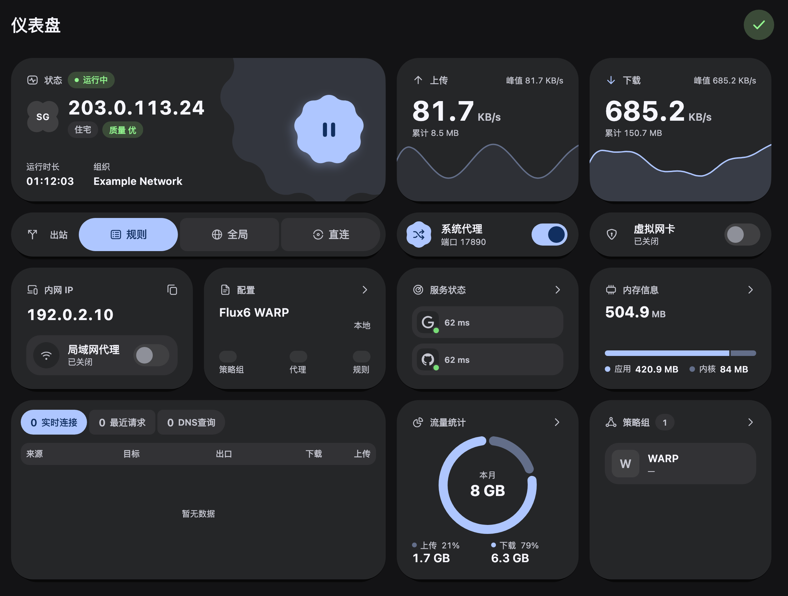
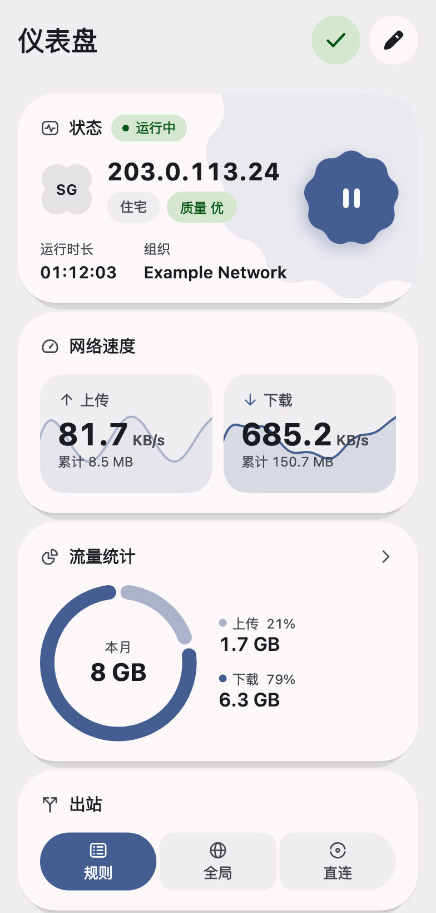

  
  <h1>Flux6</h1>
  
适用于 macOS、Android 和 Windows 的开源 WARP 客户端

  

    
    
  

[🌐 官网](https://study-233.github.io/flux6/) · [↓ 下载 0.2.0](https://github.com/study-233/flux6/releases/tag/v0.2.0) · [💬 反馈](https://github.com/study-233/flux6/issues) · [📖 开发文档](docs/development/README.md)

## Flux6 0.2.0

首次启动并同意设备注册后，Flux6 会自动生成 WARP 配置。三端使用相同的 FlClash 界面和内置 MASQUE 核心，默认接入点需要可用的 IPv6 出口，可通过 Wi-Fi 或移动网络连接。

仪表盘用圆环显示本月上传和下载占比。点开「流量统计」，可切换本次连接、本月和累计用量。需要为单个应用配置代理时，HTTP 和 SOCKS 均可使用本机默认地址 `127.0.0.1:17890`。

  
  

截图使用示例流量。完整变更见[发行说明](docs/releases/v0.2.0.md)。

## 下载安装

| 平台 | 0.2.0 正式版 | 安装 |
| --- | --- | --- |
| macOS 14 及以上 · Apple Silicon | [DMG](https://github.com/study-233/flux6/releases/download/v0.2.0/Flux6-0.2.0-macos-arm64.dmg) | 打开磁盘映像，将 Flux6 拖入「应用程序」。本版使用项目签名，未经 Apple 公证。 |
| Android 7.0 及以上 · ARM64 | [APK](https://github.com/study-233/flux6/releases/download/v0.2.0/Flux6-0.2.0-android-arm64.apk) | 在手机或平板上打开 APK，按系统提示安装。 |
| Windows x64 | [安装程序](https://github.com/study-233/flux6/releases/download/v0.2.0/Flux6-0.2.0-windows-amd64-setup.exe) · [便携 ZIP](https://github.com/study-233/flux6/releases/download/v0.2.0/Flux6-0.2.0-windows-amd64.zip) | 运行安装程序，或将便携包完整解压后启动。 |

**从 0.1.x 升级前，请先断开连接并退出旧版。** 首次运行 0.2.0 会清空旧配置、凭据和用量历史。macOS 用户请使用上方 DMG 覆盖安装。

## 致谢

感谢上游项目及开发者：

- [evansrrr / FreeV6](https://github.com/evansrrr/free-v6)，以及支持上游项目的仍需妙手、别说了，困、星汉灿烂和匿名赞助者
- [chen08209 / FlClash](https://github.com/chen08209/FlClash)
- [chen08209 / Prism UI](https://github.com/chen08209/prism_ui)
- [MetaCubeX / mihomo](https://github.com/MetaCubeX/mihomo)

## 许可证

Flux6 原有代码采用 [MIT](LICENSE)。基于 FlClash 的三端客户端和官网沿用 GPL-3.0。见[客户端许可证](apps/android/LICENSE)、[官网许可证](site/LICENSE)和[第三方许可说明](THIRD-PARTY.txt)。

## Star History

<a href="https://www.star-history.com/?repos=study-233%2Fflux6&amp;type=date">
  <picture>
    <source media="(prefers-color-scheme: dark)" srcset="https://api.star-history.com/chart?repos=study-233%2Fflux6&amp;type=date&amp;theme=dark" />
    
  </picture>
</a>
