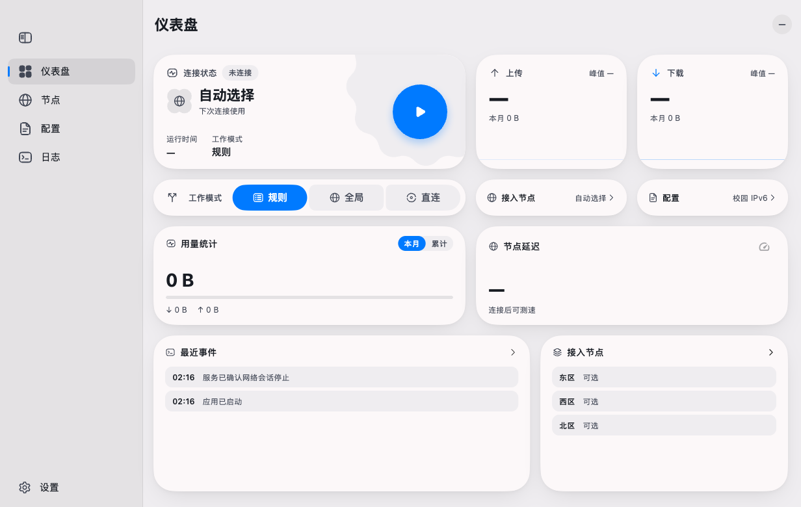
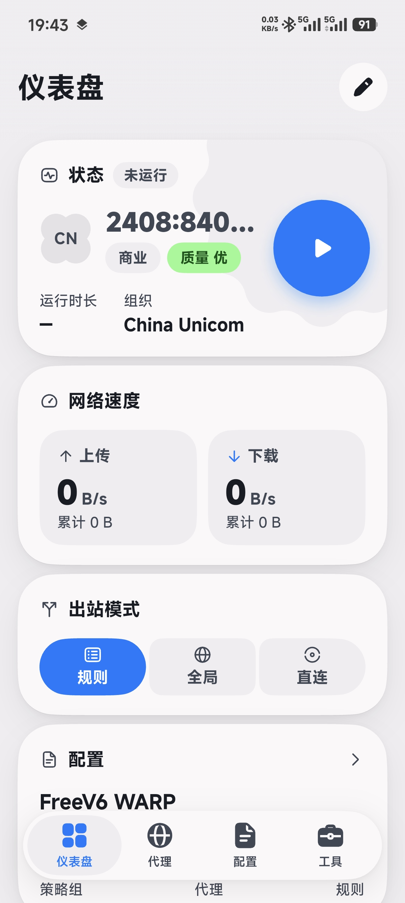

<div align="center">
  
  <h1>Flux6</h1>
  <p>教育网 IPv6 免流客户端 · macOS / Android</p>

[下载](https://github.com/study-233/free-v6/releases) · [反馈](https://github.com/study-233/free-v6/issues) · [开发文档](docs/development/README.md)

</div>

原 FreeV6。当前 0.1.0 安装包与 Homebrew 软件包仍使用 FreeV6 名称。[官网源码与本地预览](site/README.md)。

## 界面

<p align="center">
  <a href="docs/compose/audits/2026-11-07-p5-p6/visual/offline-1232.png"></a>
  <a href="docs/images/android-home.jpg"></a>
</p>

## 安装

### macOS

支持 Apple Silicon，macOS 14 及以上。推荐使用 Homebrew：

```sh
brew tap study-233/tap
brew install --cask study-233/tap/freev6
```

也可下载 [DMG 安装包](https://github.com/study-233/free-v6/releases)，将 FreeV6 拖入「应用程序」。

### Android

下载 [ARM64 APK](https://github.com/study-233/free-v6/releases) 安装。连接支持 IPv6 的 Wi-Fi，按首次引导完成配置后连接。

## 致谢

感谢上游项目及开发者：

- [evansrrr / FreeV6](https://github.com/evansrrr/free-v6)
- [chen08209 / FlClash](https://github.com/chen08209/FlClash)
- [chen08209 / Prism UI](https://github.com/chen08209/prism_ui)
- [MetaCubeX / mihomo](https://github.com/MetaCubeX/mihomo)

## 许可证

[MIT](LICENSE) · [第三方许可说明](third_party/README.md)（官网沿用 GPL-3.0）

## Star History

[](https://www.star-history.com/#study-233/free-v6&Date)
