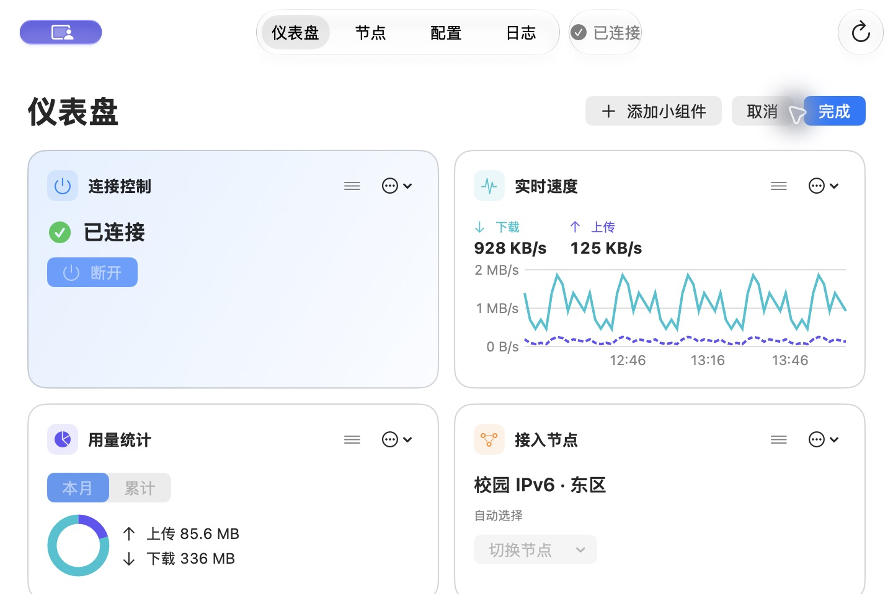
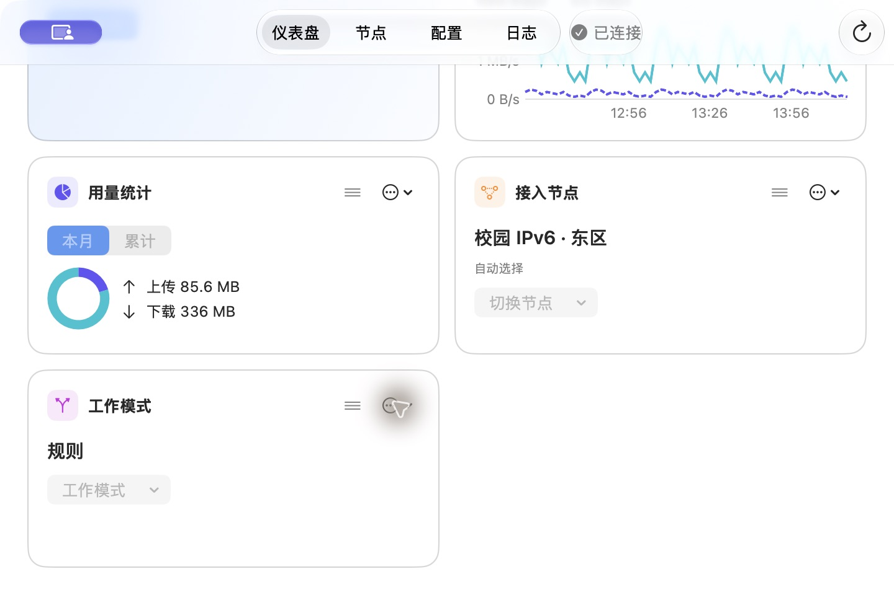
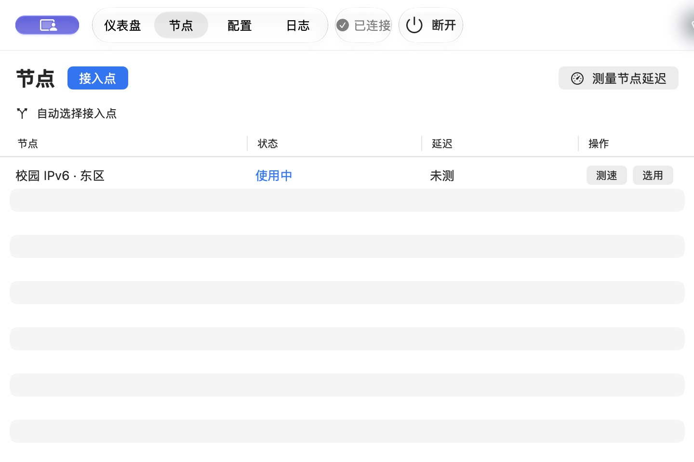
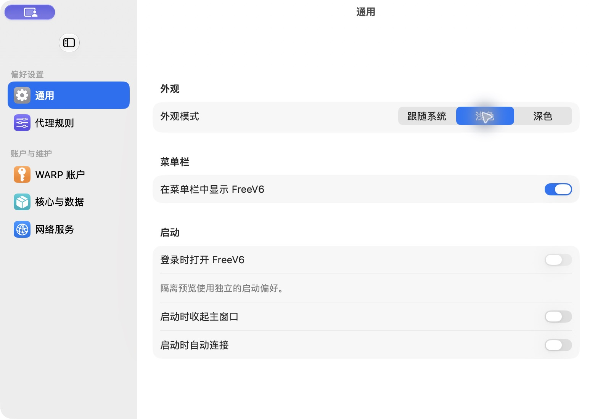

# FreeV6 macOS 界面与交互审查

后续实施已完成：[查看优化后的实际截图与复验记录](implementation.md)。本页保留改动前的证据。

2026 年 11 月 6 日 · macOS 27.0.1 · 当前 `mac` 工作树（基线 `2b5a1c0`，含未提交的界面改动）

**先修主窗口的三个行为：滚动时留下关键操作，切页时稳住四个导航标签，缩窗时保留搜索和清除筛选。** 这三处决定用户能不能在当前位置完成工作。设置窗口的主要问题是顶部多出一层，收起侧栏的按钮单独占一行，左侧类别和右侧正文都从很低的位置开始。把左栏移到另一侧并不能解决这个问题。

本次记录 **19 项发现，5 项 P1、12 项 P2、2 项 P3**。P1 影响核心操作、故障处理或失败后的输入保留。P2 有绕行方法，但容易误判状态、找错操作或重复工作。P3 主要影响界面一致性和说明的准确性。每项标出证据类型，便于区分已复现的问题和需要在正式包补测的路径。

## 用户反馈的三项问题

| 反馈 | 实际看到的现象 | 建议优先改什么 |
|---|---|---|
| 上方栏不固定 | 720 × 480 pt 滚到底，四个标签仍在，页内的「公告／编辑」和编辑态的「取消／完成」都离开视野。默认仪表盘里的「断开」也随卡片滚走。保持 920 pt 窗宽从仪表盘切到节点，整组标签又向左移约 160 pt。 | 固定一行紧凑的操作区。给四个目的地一个稳定位置，把搜索放在节点页内部。见 01、02、06。 |
| UI 缺少审美和规范 | 首页五张卡用五种类别色，连接、节点和模式等短内容与曲线共享大卡片高度。到最小窗口，「工作模式」落在第三行，右侧整列空白。仪表盘、节点、配置和日志采用不同的标题、起始边距和动作位置。 | 先按使用频率分配空间，再统一标题、边距和颜色角色。保留原生字体、表单、表格和曲线的双线型。见 08、09、18。 |
| 设置侧边栏位置不对 | 边栏确实在左侧，占 180 pt。「隐藏边栏」按钮悬在栏顶中央，下面才是「偏好设置」；右侧「通用」标题在最上方，第一节「外观」从约 y=110 pt 开始。收起后按钮移到左边，正文仍从原来的高度开始。 | 让边栏按钮归入单层窗口标题栏，两栏从同一条内容起始线展开。见 07。 |

| 最小窗口，编辑首屏 | 同一窗口，编辑最后一张卡 |
|---|---|
|  |  |

| 窗口从 920 pt 缩到 720 pt，查询仍生效但搜索入口消失 | 设置窗口，使用正式包的标题栏与尺寸参数 |
|---|---|
|  |  |

## 审查范围和复现步骤

审查对象是当前分支的 macOS 原生 SwiftUI 客户端。使用仓库的隔离界面程序操作真实视图，节点、速率和服务状态来自模拟会话。设置另用同一份视图编译了一个临时对照程序，补齐正式设置场景的 `.windowToolbarStyle(.unified)` 和 `.windowResizability(.contentSize)`。对照程序仍使用模拟会话。所有图片都是本轮截取的窗口原图，使用 2× 像素，报告中的尺寸和位置换算为 pt。截图左上偶尔出现的紫色系统指示与应用控件无关。[隔离场景](../../../../macos/Probes/InterfaceStates.swift) · [正式窗口配置](../../../../macos/Sources/FreeV6App/FreeV6App.swift#L96-L125)

采用 `ui-ux-pro-max` 的视觉层级、导航稳定性、键盘操作、拖动替代和表单反馈规则。窗口行为按 macOS 原生界面检查，重点是「用户在当前窗口能否找到、执行并确认这一步」。**实测**表示已操作并核对截图或系统辅助功能树，**实现**表示当前源码足以说明行为，但该分支未在正式环境触发。设计调整和验收尺寸均为本项目建议。

| 步骤 | 操作与结果 | 对应证据 |
|---|---|---|
| 1. 仪表盘与编辑 | 920 pt 下五张卡均可见。720 pt 下访问末行，四个导航标签保留，编辑提交动作离开视野。 | [默认](screens/01-overview-initial.jpg) · [小窗顶部](screens/02-compact-top.jpg) · [小窗底部](screens/03-compact-bottom.jpg) · [编辑顶部](screens/07-compact-edit.jpg) · [编辑底部](screens/08-edit-bottom.jpg) |
| 2. 设置与外观 | ⌘, 可进入独立设置并切换类别；边栏能收起、恢复。两种窗口配置均复现顶部留白。浅、深色均有样本。 | [通用](screens/04-settings-general.jpg) · [收起](screens/05-settings-hidden.jpg) · [规则](screens/06-settings-rules.jpg) · [深色](screens/22-settings-dark.jpg) · [深色首页](screens/23-dashboard-dark.jpg) · [对照深色](screens/25-settings-production-scene.jpg) · [对照浅色](screens/26-settings-production-light.jpg) |
| 3. 节点查找与测速 | 默认宽度可搜、可测。筛出东区后测速，清除筛选发现三个节点均得到结果。缩窗则失去搜索入口。 | [节点](screens/09-nodes.jpg) · [筛选](screens/10-nodes-filter.jpg) · [测速结果](screens/11-nodes-result.jpg) · [小窗节点](screens/20-compact-nodes.jpg) · [小窗带筛选](screens/21-filter-compact.jpg) |
| 4. 首次准备与恢复 | 首次阅读的文档区与底部按钮分开。准备未就绪时「完成」可以关闭面板；恢复失败时节点页正文仍提示先连接。 | [首次阅读](screens/17-startup.jpg) · [准备面板](screens/13-setup.jpg) · [恢复失败的节点页](screens/12-recovery-nodes.jpg) |
| 5. 配置与保存 | ⌘S 能提交，失败保留草稿，重新载入会询问是否放弃。错误留在底栏，没有带回出错的行。仪表盘切模式同时改变下次连接。 | [配置](screens/14-configuration.jpg) · [校验失败](screens/15-save-error.jpg) · [模式切换后](screens/24-mode-changed.jpg) |
| 6. 日志、公告与菜单 | 暂停日志会明确说明后台仍记录。未读公告要再展开才有内容。测试菜单可读到状态、模式、速率和断开命令。 | [日志暂停](screens/16-logs-paused.jpg) · [小窗日志](screens/19-compact-logs.jpg) · [公告](screens/18-notice.jpg)。菜单使用辅助功能树核对，原生菜单跟踪期间无法截取独立菜单图。 |

## P1 · 首轮应处理

### 01　仪表盘最需要的操作随内容滚走

**实测。** 在 720 × 480 pt 的已连接仪表盘访问最后一张「工作模式」卡，顶部仍能换页、看状态和刷新，但无法在当前位置点「断开」。编辑态访问同一卡的菜单后，「完成」「取消」都在屏外。源码把整行页头放在 `ScrollView` 内；布局里存在连接卡时又从窗口工具栏拿掉启停按钮，编辑时卡内按钮也禁用。用户可以回顶部或找应用菜单，但离开了正在处理的位置。[普通底部](screens/03-compact-bottom.jpg) · [编辑底部](screens/08-edit-bottom.jpg) · [页头与滚动区](../../../../macos/Sources/FreeV6App/OverviewView.swift#L36-L58) · [工具栏条件](../../../../macos/Sources/FreeV6App/NativeCommands.swift#L114-L129)

**改法与验收。** 在内容外放常驻连接／恢复动作，编辑期间固定「添加」「取消」「完成」。普通态公告和编辑可收进页内工具区。用默认五卡在最小窗口编辑最后一张卡，鼠标可直接完成或取消；普通态从同一位置可断开；底部内容和键盘焦点均未被固定区盖住。

### 02　缩窗后，节点筛选继续生效，搜索和清除入口却消失

**实测。** 在 920 pt 搜「东区」，三行变一行。缩到 720 pt，仍只剩东区，但查询文本、清除按钮和搜索图标全部消失，辅助功能树中也没有搜索框；⌘F 未唤回输入框。恢复 920 pt 后「东区」和清除按钮重新出现。用户很容易以为其他节点已经下线。[筛选时](screens/10-nodes-filter.jpg) · [缩窗后](screens/21-filter-compact.jpg) · [搜索与过滤实现](../../../../macos/Sources/FreeV6App/LiveNetworkViews.swift#L121-L125) · [搜索放置位置](../../../../macos/Sources/FreeV6App/LiveNetworkViews.swift#L167-L172)

**改法与验收。** 将查找放到节点页固定工具区。窄窗可折成「搜索」按钮；查询有效时始终显示查询词和清除动作。在 720 pt 下可直接查找、改词、清除，不需要放大窗口。用零结果和一条结果两种情况复验，并确认清除后回到三行。

### 03　网络需要恢复时，节点页仍告诉用户先连接

**实测。** 在「恢复失败」场景按 ⌘2，标题栏正确显示「网络需要恢复」和「重试恢复网络」。同屏中央却显示「连接后查看节点」，正文唯一按钮是「仪表盘」。窗口同时给出恢复、连接和跳页三种方向。当前实现对所有非运行阶段共用同一份正文。[恢复现场](screens/12-recovery-nodes.jpg) · [节点页状态分支](../../../../macos/Sources/FreeV6App/LiveNetworkViews.swift#L151-L169)

**改法与验收。** 让正文和工具栏读取同一会话状态。恢复中写明正在做什么，恢复失败时正文直接提供「重试恢复网络」，普通断开才提示连接。分别注入未连接、连接中、被占用、恢复失败、恢复成功五种状态，核对标题、正文和主按钮描述的是同一件事。

### 04　首次准备没完成，也可以点默认按钮「完成」

**实测。** 网络服务尚未设置、数项仍为「尚未检查」时，面板右上「完成」已经可用。点它立即关闭，回到仍提示「请先设置网络服务」的仪表盘。**实现补充。** 正式的安装失败路径把错误写入应用模型；首页会显示该错误，当前准备面板中的服务详情只显示说明和安装按钮。用户最需要原因和重试时可能还得先关闭面板。[准备面板](screens/13-setup.jpg) · [面板默认按钮与服务详情](../../../../macos/Sources/FreeV6App/OverviewView.swift#L102-L155) · [安装错误处理](../../../../macos/Sources/FreeV6App/AppModel.swift#L574-L592)

**改法与验收。** 未就绪时用「稍后继续」或「关闭」，把焦点留给当前可执行的准备步骤。每项标出待处理、进行中、就绪或失败。所有必要项就绪才提供「连接」。模拟拒绝授权和安装失败时，错误和重试要出现在同一面板；按 Return 不能让未完成操作看起来已经成功。

### 05　导入失败之前就关闭弹窗并清空输入，无法就地重试

**实现。** 链式订阅和备用配置自定义地址均只检查非空。提交后先关闭弹窗，关闭时清空地址，再异步尝试导入。格式错误或网络超时后，错误出现在底层页面，重新打开只会得到空字段。这对含令牌的长地址尤其费力。测试程序禁用了真实导入，本项由两条正式代码路径确认。[订阅输入](../../../../macos/Sources/FreeV6App/ChainSettingsSection.swift#L43-L55) · [备用地址](../../../../macos/Sources/FreeV6App/CloudSettingsSection.swift#L77-L89)

**改法与验收。** 提交时在原弹窗显示进行中；成功或用户取消后再清空。使用虚构地址覆盖格式错、超时和成功三种结果。失败时保留遮蔽输入、就地给原因、可直接修改重试；不得把令牌原文放进错误说明。

## P2 · 可操作性与视觉一致性

| 编号／发现 | 证据、影响 | 改法与验收 |
|---|---|---|
| **06　换页时主导航横向跳动** | **实测。** 同为 920 pt，仪表盘标签组左缘约 x=306 pt，切到节点约 x=146 pt，位移约 160 pt。节点搜索占用右侧标题栏，反复点同一位置会落到不同控件。[仪表盘](screens/01-overview-initial.jpg) · [节点](screens/09-nodes.jpg) · [原生标签结构](../../../../macos/Sources/FreeV6App/FreeV6App.swift#L159-L179) | 为四个目的地保留稳定区域；页面搜索、日志筛选等在各页操作区适配。保持窗宽轮切四页，检查四个标签中心位置，同时验证 ⌘1–⌘4。 |
| **07　设置侧栏的开关单独占一行，与内容脱节** | **实测。** 780 × 550 pt 下边栏宽 180 pt，开关中心约 x=90、y=56 pt，右侧页名靠顶部，首节从约 y=110 pt 开始。收起时开关横移到约 x=28 pt，顶部空白仍在。正式场景参数的两种外观均复现。[展开](screens/26-settings-production-light.jpg) · [收起](screens/05-settings-hidden.jpg) · [深色对照](screens/25-settings-production-scene.jpg) · [分栏实现](../../../../macos/Sources/FreeV6App/PreferencesView.swift#L52-L69) | 将开关并入正常窗口标题行，选中分类和首个内容节对齐。保留原生分栏、选中态、⌘, 和键盘列表导航。用 780 × 550 和代码允许的 640 × 440 pt 复测，收起和恢复时内容起点稳定、选中项不丢。 |
| **08　简单的动作和复杂的图表占用同样的高度** | **实测＋实现。** 速度卡最小高 184 pt，其他卡 160 pt。小窗默认五卡分三行，单是卡片和间距就至少 528 pt；「工作模式」独占最后一行左半边。连线趋势需要图高，而「规则」和一个菜单不需要这么大的面积。五色图标又给了每张卡接近的视觉权重。[小窗](screens/02-compact-top.jpg) · [最后一行](screens/03-compact-bottom.jpg) · [卡片样式](../../../../macos/Sources/FreeV6App/DashboardGrid.swift#L164-L200) · [网格](../../../../macos/Sources/FreeV6Desktop/DashboardLayout.swift#L86-L112) | 给连接状态和动作明确的首要位置，节点和模式采用紧凑行，速度图保留独立高度；类别图标弱化，状态色与图例色有固定含义。验收以默认布局能否直接找到断开、当前节点、当前模式为准，同时复验自定义顺序和尺寸。 |
| **09　浅色下载标签偏淡，和深色表现差异大** | **实测抽样。** 「下载」以小号青绿色文字显示。对同一区域的截图像素抽样，浅色相对周围背景约 2.3:1，深色约 8.8:1。设置组标题在深色侧栏也较难辨认。曲线本身已有实线／虚线、方向箭头和数值，可继续保留。[浅色](screens/01-overview-initial.jpg) · [深色](screens/23-dashboard-dark.jpg) · [速率标签](../../../../macos/Sources/FreeV6App/DashboardCards.swift#L134-L139) | 让文字采用语义前景色，把青绿和靛蓝留给线条、方向符号，或选择各外观专用的文字颜色。按实际渲染前景／背景复核普通说明文字 4.5:1 的设计目标，另测系统增强对比度。截图抽样用于定位，不能代替原生颜色与辅助功能验证。[对比度参考](https://www.w3.org/WAI/WCAG22/Understanding/contrast-minimum.html) |
| **10　工作模式操作没有说明会改下次默认值** | **实测。** 仪表盘从「规则」切到「全局」，再按 ⌘3，「当前会话」和「下次连接模式」都变成全局。入口只列模式名称。成功时容易当作临时切换，保存失败时才明确说明两件事的结果。[切换前](screens/14-configuration.jpg) · [切换后](screens/24-mode-changed.jpg) · [切换与持久化](../../../../macos/Sources/FreeV6App/AppModel.swift#L366-L373) | 在菜单或紧邻操作处说明「立即生效，同时用于下次连接」。成功时呈现两个结果，持久化失败时分别说明。分别测试保存成功、保存失败和已有规则草稿的情况。 |
| **11　筛选一个节点，批量测速却测全部节点** | **实测。** 三个节点初始均未测。搜东区后只见一行，点「测量节点延迟」，清除搜索，东、西、北三区均显示 28 ms。28 ms 是模拟值；得到测速结果的节点数才是这里的证据。[筛选](screens/10-nodes-filter.jpg) · [清除后](screens/11-nodes-result.jpg) · [批量命令](../../../../macos/Sources/FreeV6App/AppModel.swift#L484-L485) | 默认测当前结果，按钮写「测量 1 个结果」；如需保留整组测量，另给「测量全组 3 个节点」。零结果禁用按结果测速，进行中可停止。 |
| **12　规则错误留在底栏，没有定位到出错的行** | **实测。** 在黑名单第三行输入 `https://bad.example`，折叠黑名单再按 ⌘S。底栏出现「请求内容无效：invalid domain…」，折叠组只显示「3 条」。草稿正确保留，但用户要自己定位和理解错误。[失败截图](screens/15-save-error.jpg) · [底部错误与编辑器](../../../../macos/Sources/FreeV6App/BusinessSettingsView.swift#L235-L264) | 自动展开并聚焦相应行，显示「黑名单第 3 行需要域名，请移除 https://」。保留其余输入，修正后可用同一快捷键保存；读屏能从错误提示移动到该字段。 |
| **13　同一配置页混用三种保存规则** | **实测＋实现。** 主窗工具栏与底栏同时提供重载、保存。底部「保存配置」只处理规则草稿；校园登录地址另有「保存地址」，部分开关又立即写入。用户只改地址时，页底保存可能仍是禁用状态。[主窗配置](screens/14-configuration.jpg) · [设置中的同一表单](screens/06-settings-rules.jpg) · [地址和开关](../../../../macos/Sources/FreeV6App/CloudSettingsSection.swift#L27-L42) | 将底栏命名为「保存代理规则」，或让页级保存对整份编辑内容生效；即时项明确标「立即保存」。保留固定反馈区，减少重复按钮。只改地址、只改规则和两者一起改时，⌘S、切页和退出结果应可预测。 |
| **14　从设置导入文件会抢走主窗口的焦点** | **实现。** 在独立设置的「代理规则」点「导入链式代理配置…」，命令先将主窗口切到配置页并置前，再打开选择器。即使取消，原来的主窗口页已经改变。备用 YAML 的选择器则附着在发起它的表单。[设置入口](../../../../macos/Sources/FreeV6App/ChainSettingsSection.swift#L25-L32) · [主窗口切换](../../../../macos/Sources/FreeV6App/AppModel.swift#L486-L500) · [备用文件选择器](../../../../macos/Sources/FreeV6App/CloudSettingsSection.swift#L66-L71) | 在发起窗口展示选择器。让主窗口先停留在日志，再从设置发起导入并取消；设置保持前景，主窗口仍停留在日志。 |
| **15　读取失败、没有节点和读取恢复后使用了相互冲突的提示** | **实现。** 已连接但读取失败时，节点页可同时显示「当前会话没有可显示的节点分组」和错误，仪表盘可能仍写「正在读取节点…」。之后读取成功会更新列表，却没有在该成功分支清除上次的读取错误。[节点空态](../../../../macos/Sources/FreeV6App/LiveNetworkViews.swift#L151-L169) · [仪表盘节点卡](../../../../macos/Sources/FreeV6App/DashboardCards.swift#L27-L37) · [读取成功与失败](../../../../macos/Sources/FreeV6Desktop/DesktopCoreControls.swift#L46-L59) | 拆分加载中、合法空组、读取失败和已恢复。注入「超时 → 下一次成功」，应先有重试，再显示列表并移除该次读取错误。切换节点或测速的独立错误应分别管理。 |
| **16　退出应用会静默丢失未提交的仪表盘布局** | **实现。** 卡片调整保存在内存草稿，点「完成」才写入偏好。退出检查关注代理规则的改动；仅修改布局时缺少相应处理。主窗口 ⌘W 收起和应用 ⌘Q 退出要区分。[布局保存](../../../../macos/Sources/FreeV6App/AppModel.swift#L19-L29) · [退出判断](../../../../macos/Sources/FreeV6App/AppModel.swift#L605-L632) | 有实际调整时提供保存、放弃或回到编辑；也可采用可撤销的自动保存，但需与「取消」语义一致。复验移动／移除卡片后 ⌘Q、⌘W 后重开，以及进入编辑但没有改动。 |
| **17　点未读公告后还要再找一次，展开就把所有条目标已读** | **实测＋实现。** 点「公告 · 1」进入一个大面板，正文仍收在「查看公告」下面。展开后代码一次把全部当前 ID 记为已读；若多条内容超出视野，未看到的也一起计入。[打开后的第一屏](screens/18-notice.jpg) · [已读逻辑](../../../../macos/Sources/FreeV6App/MaintainerNoticeView.swift#L7-L16) · [展开展示](../../../../macos/Sources/FreeV6App/MaintainerNoticeView.swift#L35-L54) | 打开后直接展示第一条未读标题和正文。单条展开或明确执行「全部标为已读」才清除相应计数。用多条长公告测试，只看第一条就关闭，剩余条目仍应未读。 |

## P3 · 可与相关页面一起修

**18　统一页面标题、正文起点和日志状态提示。** 仪表盘标题使用 `largeTitle`、22 pt 外边距，节点使用 `title`、16 pt，日志标题为 18 pt 水平边距，而日志存储／暂停提示直接贴左边。配置页则从居中的表单分节开始。原生表格可以贴窗边，说明文字仍应与标题共享左缘。保留日志已有的「显示已暂停，后台继续记录事件」和文字级别；将警告与普通暂停提示分出层级。验收时在同一窗宽轮换四页看左缘，再同时触发暂停和存储错误。[首页](screens/01-overview-initial.jpg) · [节点](screens/09-nodes.jpg) · [日志](screens/16-logs-paused.jpg) · [日志布局](../../../../macos/Sources/FreeV6App/DiagnosticsView.swift#L98-L112)

**19　故障和升级指引仍让用户去找「概览」。** 当前四个目的地是「仪表盘、节点、配置、日志」。资源校验及升级恢复文案仍出现「在概览中继续准备」「从概览重新登记」，故障用户无法按字面找到页面。统一名称，并让恢复提示直接打开相应准备步骤。验收覆盖安装中断、核心校验结束、更新后重新登记三种文案。[核心准备说明](../../../../macos/Sources/FreeV6App/RuntimePreparationView.swift#L84) · [升级恢复提示](../../../../macos/Sources/FreeV6App/NativeUpdates.swift#L66-L75)

## 可直接用于改版的界面规则

- **窗口。** 四个目的地位置稳定；连接状态、启停／恢复动作形成一个持续可见的区域。当前页拥有自己的固定操作行，仅内容区滚动。现有配置页底栏和首次阅读页已经展示了固定动作与独立滚动区的做法。
- **信息顺序。** 默认首页先回答「能否连接、现在经过哪个节点、正在用什么模式」，再给速度趋势和用量。首屏优先服务判断和操作。保留自定义卡片、原有顺序、⌘1–⌘4 和 ⌘,。
- **文字与间距。** 保留系统字体；四个主页面共享一套标题与操作行规格。建议从内容外边距 16–20 pt、同组间距 8 pt、区块间距 16 pt 开始试排，复杂图表与简单控制分别定高。这些是待验证的项目取值。
- **颜色。** 系统强调色标识当前可执行的主要动作与选择。运行、警告、失败同时有文字和符号；为上传和下载保留稳定的线型与颜色。类别图标可以弱化，减少与状态色争夺注意力。
- **焦点与反馈。** 页内错误返回到字段，弹窗请求在原处完成。卡片非拖动排序已有「前移／后移」，应继续保留；节点行操作应能读成「测量东区延迟」而非只读「测速」。目前辅助功能树包含行描述和图表数值，但完整 VoiceOver 读序仍需实听。[卡片菜单](../../../../macos/Sources/FreeV6App/DashboardGrid.swift#L173-L191) · [节点行按钮](../../../../macos/Sources/FreeV6App/LiveNetworkViews.swift#L140-L148)

## 修复顺序与交付验收

| 顺序 | 范围 | 完成条件 |
|---|---|---|
| 第一轮 · 窗口骨架 | 01、02、06、07，联动 08、18 | 720 × 480 与 920 × 620 下四个标签位置稳定；底部仍能结束编辑和断开；节点查询可以查看与清除；设置的开关回到标题行。 |
| 第二轮 · 首次使用与失败恢复 | 03、04、05、12、15、19 | 未就绪时不暗示已经完成；恢复失败只有一种清晰的下一步；错误保留输入并定位；重试成功后清除对应告警。 |
| 第三轮 · 行为和视觉细节 | 09、10、11、13、14、16、17 | 模式和批量操作事先说明范围；导入与退出保护上下文；公告已读计数可验证；两种外观的标签和图线可辨。 |

**仍需验证的边界。** 本轮操作了隔离客户端及设置对照副本，覆盖鼠标、若干键盘快捷键和系统辅助功能树。未安装或修复系统网络服务，未启停真实隧道，未使用真实订阅或凭据。Windows/Tauri、macOS 14 的标准标签回退、正式包真实菜单栏、VoiceOver 完整读序，以及增大对比度／减少透明度／减少动态效果均留作发布前验收。首次阅读使用测试文案；日志提示无法存储属于当时测试状态，不能据此判断正式包的日志存储。浅色和深色对比度数值是 JPEG 中标签区域较强字形像素相对背景的近似值，用于筛查。报告与截图是本轮新增的项目交付物，产品实现未作修改。
