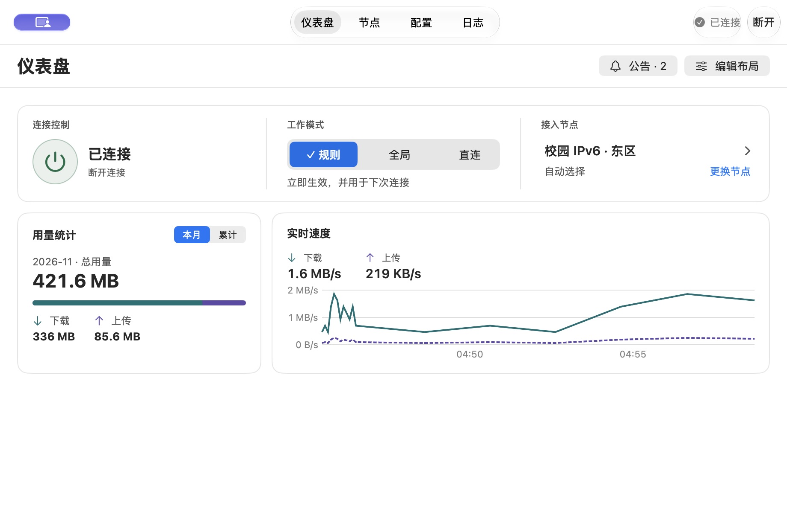

# FreeV6 macOS 界面优化 · 实施与复验

**后续修订：** [第二轮反馈、截图与测试方法](followup/README.md)。下文保留第一轮记录；未连接时的模式、节点、速度图，以及导航、用量和日志行为，以第二轮为准。

2026-11-06 · 对照[原审查的 19 项发现](README.md)和[优化计划](../../spec/macos-ui-optimization-plan.md)。以下是已实现界面的实际结果。操作对象是与正式客户端共用视图和命令的[原生隔离程序](../../../../apps/macos/Probes/InterfaceStates.swift)，服务、节点与流量使用测试数据。窗口尺寸以 pt 表示，截图为 2× 原图。

| 用户要完成的事 | 改动及实测 | 对应证据 |
|---|---|---|
| 在任意页面找回导航与会话操作 | 四个目的地和会话动作留在原生标题栏。920 pt 逐页切换，取同一水平扫描线测到导航外缘始终在 x≈340–584 pt。720 pt 将仪表盘编辑区滚到底，滚动条值为 1，仍可见「取消」「完成」和「断开」。从标题栏断开后出现「未连接 / 连接」，重连后恢复「已连接 / 断开」。 | [节点](after/13-nav-nodes.jpg) · [配置](after/15-nav-config.jpg) · [日志](after/14-nav-logs.jpg) · [编辑到底](after/11-edit-scrolled.jpg) |
| 一眼找到连接与当前模式 | 圆形电源键、状态和动作组成同一点击区域。规则、全局、直连常驻；确认成功才移动勾选。试过规则 → 全局；模拟直连生效但默认值写入失败，提示「当前已切至直连；下次连接使用全局」。模拟会话切换失败后旧选中项保留，就地重试成功。断开后三段仍显示，提供「设置下次模式」。 | [最小窗口](after/02-dashboard-720.jpg) · [深色小窗](after/10-dashboard-dark-720.jpg) |
| 查看用量与实时速度 | 已核对本月／累计切换后，读屏信息同时包含周期、总量、上下行；夹具中 336 MB 下载 + 85.6 MB 上传对应 421.6 MB。单元测试另覆盖零值、单向流量及超出常规 64 位求和范围。图例保留方向与实／虚线。抽样默认窗口实时速度的「下载」文字，浅色约 7.2:1、深色约 8.0:1（对同一 JPEG 字形区域取较强字形像素，与邻近底色比较；不代表整个界面的对比度认证）。 | [浅色](after/01-dashboard-920.jpg) · [深色](after/09-dashboard-dark.jpg) |
| 找到节点、选择并确认结果 | 当前节点整行打开浮层，焦点进入搜索。默认明确区分「✓ 自动选择」与「东区 · 使用中」；搜「西区」后按方向键、Return 成功，节点行改为「西区 / 首选：西区」。模拟选择失败后，浮层、查询和重试均保留，重试成功关闭。 | [节点浮层](after/03-node-picker.jpg) |
| 缩窗继续筛选或测速 | 920 pt 搜「西区」，缩到 720 pt 仍显示搜索词、清除和「测量 1 个结果」。单结果测出夹具值 12 ms；全组测速独立。模拟读取超时，原处重读后保留筛选；合法空组提示「暂无可用节点」。模拟本人会话恢复失败，节点正文与标题栏均显示「重试恢复网络」。 | [窄窗筛选](after/04-nodes-filter-720.jpg) |
| 在设置里导航、导入和纠错 | 侧栏开关现在是原生标题栏附件，与窗口控制同排。780×550 与 640×440 均核对；隐藏和展开不额外占一行。从设置的代理规则页按 ⌘O，取消后仍在同一设置页。模拟订阅导入超时，遮蔽输入与焦点都保留。在含空行的黑名单中输入无效网址并按 ⌘S，显示原始第 3 行与中文改法。页级保存命名为「保存代理规则」；校园登录地址单独保存。 | [默认设置](after/05-settings.jpg) · [小设置窗口](after/07-settings-640.jpg) · [遮蔽输入重试](after/06-import-retry.jpg) · [字段错误](after/08-rule-validation.jpg) |
| 准备、退出和阅读公告 | 模拟服务授权失败，在发起步骤看到了错误和重试动作；未完成时能选「稍后继续」。布局草稿有改动时 ⌘Q 出现保存、放弃、返回编辑；实测返回后草稿仍可编辑。首次打开两条未读公告，只展开首条；关闭后未读数由 2 变为 1。帮助、更新提示、随包安装说明使用「仪表盘」。 | [布局退出提示](after/12-unsaved-layout.jpg) |

**布局兼容性。** 测试程序原本保存了旧顺序；启动新版时该顺序仍有效。使用「编辑布局 → 添加小组件 → 恢复默认布局」，再点「完成」，才切到新的默认顺序。解码与网格测试覆盖空布局、未知组件、去重、移动、跨度、换行和窄／宽窗口。[布局测试](../../../../apps/macos/Tests/FreeV6DesktopTests/DashboardLayoutTests.swift)

**构建与测试。** 已在 macOS 27.0.1 构建面向 macOS 14 的 arm64 Release 应用并执行 `codesign --verify --deep --strict`。本轮原生回归共 **157 个不同测试，全部通过**：带 worker、进程及官方资源夹具的全量回归通过 156 项，另有 1 项选择性临时钥匙串测试，单独启用后通过。测试不使用个人钥匙串。本地可运行的包位于 `dist/macos/FreeV6.app`；隔离 UI 使用 `scripts/macos/build-ui-fixture.sh` 生成。客户端没有安装到系统，也没有启用真实隧道。

**发布前仍需单独验证。** 此轮验证包括实际窗口、鼠标、键盘和辅助功能树；未在 macOS 14 或 Intel 硬件上运行，未验证完整 VoiceOver 朗读顺序及系统增强对比度／减少透明度／减少动态效果组合，也未进行正式网络服务安装、真实校园出口、DNS 恢复及真实订阅的端到端测试。日志页在隔离环境显示存储不可用时仍允许导出；这张截图用于核对布局，不能用来推断正式包的磁盘行为。
