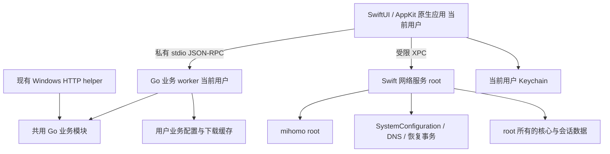

# FreeV6 macOS 支持分析与实现计划

开发分支：`mac`。逐步交付与验证证据记录在[开发进度](/Users/andy/Study/free-v6/docs/compose/spec/macos-development-progress.md)。下文的原代码审计以 c528f26 为基线；当前实现状态以进度记录和实际代码为准。

推荐为 Mac 新建独立的 SwiftUI + AppKit 原生客户端，用 Swift 实现系统集成和特权网络服务，复用现有 Go 业务逻辑与 mihomo 网络核心。Windows 继续使用现有 Tauri 客户端。两端共享注册、订阅解析、配置规则与测试样本，分别维护符合各自平台习惯的界面。

本次修订替代原先的“Tauri 界面适配 Mac”路线：Mac 不再承担旧 WebKit 兼容、Rust 桌面壳移植和 Tauri updater 接入，而是新增原生界面、Swift/Go 协议、XPC 服务及 Sparkle 更新。现有代码尚不能作为可运行的 Mac 应用交付。

本计划对应用户确认的范围：Apple Silicon 优先，最低 macOS 13；交付 DMG，暂不购买或配置 Developer ID、不做 Apple 公证；保留本机核心功能和应用内更新。Intel 评估并预留实现，热点共享在明确可行性、实现复杂度与维护要求后决定是否纳入。

## 已确认范围和建议交付边界

| 项目 | 交付目标 |
| --- | --- |
| Apple Silicon | 原生 arm64，完整本机功能，独立 DMG |
| 最低系统 | macOS 13.0；原生界面与后台服务均以此作为部署目标 |
| Intel | 保留 darwin/amd64 构建；使用兼容 CPU 基线；经 Intel 真机验证后再声明正式支持 |
| 安装 | DMG 内含 FreeV6.app 和 Applications 快捷入口，应用内安装网络服务 |
| Apple 签名公证 | 首版使用 ad-hoc 代码签名，Developer ID 和公证后置；ad-hoc 不提供 Apple 开发者身份信任 |
| 更新 | 校验版本、架构和更新签名后替换应用；更新签名独立于 Apple 证书 |
| 本机功能 | WARP 注册、TUN、规则/全局/直连模式、开发者模式、校园白名单与黑名单、节点选择与测速、链式代理、备用配置、设置、日志、流量显示 |
| 界面 | 按 macOS 原生习惯重新设计，业务功能保持一致；不要求沿用 Windows 视觉设计 |
| 代码组织 | 同一仓库内新增 Mac 原生入口；共用 Go 业务模块，保留 Windows 客户端 |
| 桌面集成 | 屏幕顶部原生应用菜单、窗口标题栏与工具栏、右上角状态栏入口、关闭隐藏、退出清理、登录启动、静默启动、自动运行、快捷键和系统主题 |
| 执行方式 | 后续开发由 Codex 按任务依赖推进，实现、验证并维护进度记录，以验收结果确认阶段完成 |
| 热点共享 | 独立可行性阶段；不默认为已经包含，也不永久排除 |

无公证 DMG 可以作为当前交付形式，但首次运行仍要遵循系统对未经公证应用的打开流程。网络服务需要的管理员授权与应用公证是两套机制。计划不依赖关闭 SIP、全局关闭 Gatekeeper 或让整个界面以 root 运行。[Apple 关于打开未知开发者应用的说明](https://support.apple.com/guide/mac-help/open-a-mac-app-from-an-unknown-developer-mh40616/mac)

## 技术选型及取舍

| 方案 | 对本项目的收益 | 成本和限制 | 结论 |
| --- | --- | --- | --- |
| 继续 Tauri + Web + Go | 复用现有界面最多，两端视觉和功能容易同步 | 仍需重做 Mac 权限与网络层；原生菜单、窗口、设置和 WebKit 兼容需要额外适配 | 适合优先降低迁移成本，和本次原生体验偏好不完全一致 |
| SwiftUI + AppKit + Go 业务模块 + Swift 网络服务 | 原生界面与系统 API 配合直接，已有网络业务可复用，Windows 业务可同步修复 | 增加 Swift 技术栈、两套界面和进程协议维护 | 推荐 |
| SwiftUI + 全 Swift 业务后端 | Mac 技术栈统一 | 需要重新实现和验证 WARP 注册、订阅解析、配置渲染及下载逻辑；与 Windows 长期分叉 | 首版不采用，后续有具体收益时再逐模块评估 |
| 改用 Flutter、Qt 或 Electron | 可另建跨平台界面 | 又一次界面迁移，仍要做原生权限服务，无法消除本项目的关键系统工作 | 当前没有足够收益支持更换 |

“原生”优先落实在用户界面、窗口行为、系统权限、网络设置和安装生命周期。Go worker 编译为本机 arm64/amd64 可执行程序，不需要用户安装 Go，也不妨碍 SwiftUI 原生体验。保留 Go 的理由是复用已有业务实现和测试，不能据此把当前 Windows helper 原样搬到 Mac。

| 职责 | 选型 | 具体边界 |
| --- | --- | --- |
| 界面 | SwiftUI，AppKit 补充 | 导航、表格、设置、菜单栏、窗口和退出流程；SF Symbols 与系统字体 |
| 流量图 | Swift Charts | 有界历史采样、后台降频；不移植 WebGL 效果 |
| 应用状态 | Swift async/await、actor、ObservableObject | UI 状态在主线程，启停串行化；macOS 13 基线不直接依赖 SwiftData 或新版 Observation |
| 业务模块 | Go | WARP、订阅/链式/备用配置、白黑名单、配置生成、核心下载、GeoSite、公告 |
| 系统网络服务 | Swift + Foundation / SystemConfiguration / Security | XPC、身份校验、root 核心安装、子进程、DNS 事务、恢复 |
| 网络数据面 | 锁定版本的 Darwin mihomo | MASQUE、TUN、规则与流量转发，继续独立进程运行 |
| 业务通信 | 私有 stdin/stdout JSON-RPC | App 启动 Go worker；Mac 不再暴露现有 13335 HTTP 控制接口 |
| 特权通信 | Foundation NSXPCConnection | App 直接连接固定 Mach service；Go worker 无特权接口 |
| 更新 | Sparkle 2 | 应用内检查和安装，发布签名独立于 Apple 证书；服务升级另行协调 |
| 构建与测试 | Xcode、Swift Package Manager、Go、XCTest/XCUITest | 固定工具和依赖版本；Mac 构建不要求 Rust 或 Web 前端工具链 |

SwiftUI 的分栏导航适合本项目的状态、节点、配置和日志页面；macOS 13 是 NavigationSplitView 的可用基线。应用菜单通过 SwiftUI Commands 实现，右上角状态栏入口采用 MenuBarExtra，复杂窗口行为通过 AppKit 补充。[Apple 导航说明](https://developer.apple.com/documentation/technotes/tn3154-adopting-swiftui-navigation-split-view)、[MenuBarExtra](https://developer.apple.com/documentation/swiftui/menubarextra)、[Swift Charts](https://developer.apple.com/documentation/charts)

两套界面的维护是明确接受的成本。通过共享业务模块、版本化协议、功能清单和跨平台测试样本控制分叉；不在 Swift 里再实现一套订阅和 WARP 业务规则。

## 项目架构和现有启动链路

| 层 | 当前实现 | 迁移判断 |
| --- | --- | --- |
| 前端 | 原生 HTML、CSS、JavaScript，Material Web 与 Lit 本地 vendoring，没有 npm 构建流水线 | 保留为 Windows 界面；Mac 复用功能定义和交互语义，重新实现原生界面 |
| 桌面壳 | Tauri 2，Rust，锁文件中 tauri 为 2.11.6；窗口、托盘、快捷键、sidecar、更新 | 保留 Windows 入口；Mac 新建 Swift 入口，避开这里的 Win32 编译依赖 |
| 普通业务 | Go 1.25，freev6-helper 提供本地 HTTP API | 提取注册、订阅、配置等为共享模块；Windows 保留 HTTP 适配，Mac 使用独立 worker |
| 网络数据面 | 外部 mihomo v1.19.31，通过配置启用 MASQUE 和 TUN | 上游已有 Darwin 构建基础，需要正确选包和实测 |
| 网络状态 | Windows PowerShell、netsh、ICS、WinRT | macOS 实现缺失，由新的 Swift 服务承担 |
| 发布 | GitHub Actions 在 Windows 构建 NSIS，发布单个 Windows 更新描述 | 新增 Mac 构建和按平台发布的更新元数据 |

当前链路是：Tauri 启动 → 用 Win32 随机数 API 生成 token → 启动 Go sidecar 并传入 FREEV6_ROOT 和 FREEV6_API_TOKEN → 前端访问 127.0.0.1:13335 → helper 渲染配置、准备 GeoSite、捕获网络快照、启动 mihomo → 前端直接携带 controller secret 访问 127.0.0.1:9090。

运行状态主要保存在安装根目录下的 config、state、runtime 中。前端的主题和累计流量等另有 localStorage 状态。CLI 的 start/stop 与 GUI helper 存在重复的生命周期逻辑。Mac 的诊断与恢复命令统一连接原生服务；现有 Go CLI 不直接作为 Mac 的网络启停入口。

## 阻碍 macOS 支持的具体问题

以下是当前实现的审计结果。原生方案避开 Rust/Web 的 Mac 移植工作，但核心资产、配置、权限、目录与恢复问题仍需解决；这些问题不能因更换界面而消失。

### 编译和构建

1. [tauri.conf.json](/Users/andy/Study/free-v6/src-tauri/tauri.conf.json:8) 的构建前命令使用 del、move、Windows 路径和固定的 x86_64-pc-windows-msvc sidecar 名；bundle.targets 仅为 nsis。
2. [main.rs](/Users/andy/Study/free-v6/src-tauri/src/main.rs:93) 无条件链接 advapi32、user32、kernel32，使用 SystemFunction036、RegisterHotKey、MessageBoxW 等 Win32 API；update_apply 无条件导入 std::os::windows::process::CommandExt。这是明确的 Darwin 编译或链接阻碍。
3. [build.rs](/Users/andy/Study/free-v6/src-tauri/build.rs:1) 围绕 Windows manifest 配置。若选择继续移植 Tauri，需要隔离这些配置；当前原生方案不编译此入口。仅设置 WindowsAttributes 未必本身就造成 Mac 编译失败，不能与上述无条件 Win32 调用混为一谈。
4. 当前没有 Mac 图标、Mac bundle 配置、服务安装资源或 Darwin CI。

### 核心下载和识别

[download.go](/Users/andy/Study/free-v6/internal/mihomo/download.go:24) 固定下载 Windows amd64-v3 ZIP，哈希也只对应该包。临时文件固定为 .zip；解压器虽然有 gzip 分支，但靠临时文件扩展名选择格式，输出名仍固定为 Windows .exe。只替换 URL 仍会失败。

[runtime.go](/Users/andy/Study/free-v6/internal/mihomo/runtime.go:15) 根据 GOOS 和 GOARCH 拼文件名，却对所有平台加 .exe；两个发现测试也硬编码 Windows 名称。因此 Go 使用了跨平台语法，并不代表运行时和测试已经跨平台。

上游固定版本的构建工作流包含 darwin/arm64 和 darwin/amd64，并对非 Windows 输出 gzip。实施时应核实对应 release 资产存在、下载并锁定实际摘要，不凭文件名推测 SHA256。Intel 优先选择 amd64-v1，避免直接沿用当前 Windows amd64-v3 的 CPU 要求。[mihomo v1.19.31 构建工作流](https://github.com/MetaCubeX/mihomo/blob/v1.19.31/.github/workflows/build.yml)

### 权限和网络操作

[snapshot_other.go](/Users/andy/Study/free-v6/internal/network/snapshot_other.go:10) 的 CaptureSnapshot 直接返回 ErrWindowsOnly；RestoreSnapshot 也返回该错误。helper 的 startProxy 无条件捕获快照，因此即使手动放入可执行的 Darwin mihomo，当前启动链路仍会在这里失败。[启动调用点](/Users/andy/Study/free-v6/cmd/freev6-helper/main.go:643)

非 Windows 的 IsAdministrator 固定返回 false，而 helper 仅在 Windows 执行管理员检查。macOS 没有权限安装、授权拒绝、服务故障或权限撤销的状态模型。Windows 当前依赖整个桌面程序提权，再由 sidecar 继承权限；Mac 版应改为普通用户界面配合专用网络服务。

### TUN 和 DNS

[config.go](/Users/andy/Study/free-v6/internal/mihomo/config.go:197) 将 device 固定为 FreeV6TUN，并共用 strict-route、auto-route、dns-hijack 等字段。Mac 应使用动态 utun 设备，记录实际设备名和本次会话所拥有的资源。

这里有一个需要准确区分的细节：固定版本 mihomo 会检查 Darwin 设备名，对 FreeV6TUN 这类不合法名称警告并重新生成 utun 名称。因此这一配置不能直接判定为必然启动失败，但依赖 Windows 固定名称的上层逻辑不能沿用。[固定版本 TUN 实现](https://github.com/MetaCubeX/mihomo/blob/v1.19.31/listener/sing_tun/server.go)

DNS 是实际功能风险：发往局域网 DNS 的请求不能假定被 dns-hijack 自动接管；strict-route 的 Windows 行为也不能当作 Mac 的泄漏防护。当前 DNS 监听 0.0.0.0:1053，系统 DNS 设置通常只接受地址，不能简单把系统 DNS 写成 127.0.0.1 就假设请求会到 1053。[mihomo TUN 文档](https://wiki.metacubex.one/en/config/inbound/tun/)

当前上游文档出现的 dns-mode 不能直接抄入本项目：检查 v1.19.31 的配置结构没有该字段。Mac 方案必须基于锁定核心做真实解析和流量测试；升级核心应作为单独决策。[v1.19.31 配置源码](https://github.com/MetaCubeX/mihomo/blob/v1.19.31/config/config.go)

### 数据目录和资源

Rust 将 current_exe().parent() 传给 FREEV6_ROOT；在 .app 内这通常对应 Contents/MacOS。继续在这里写 config、state 和 runtime，会产生安装位置权限、签名完整性和升级丢数据问题。[start_helper](/Users/andy/Study/free-v6/src-tauri/src/main.rs:543)

GeoSite 的种子文件查找也假设 state 的父目录就是安装根，而 Mac bundle 的资源目录与可执行文件目录不同。Rust 的 settings_flag 同样从可执行文件旁读取。原生方案通过 Bundle 和显式目录契约解决 Mac 的资源定位，不复用这段 Rust 路径推断。[geodata.go](/Users/andy/Study/free-v6/internal/mihomo/geodata.go:194)

### 退出和崩溃恢复

[process.go](/Users/andy/Study/free-v6/internal/mihomo/process.go:75) 停止 mihomo 时直接 Kill；Start 没有对应的 Wait 回收。Unix 下需要优雅终止、限时等待和子进程回收，不能以删除 PID 文件表示停止完成。

[process_unix.go](/Users/andy/Study/free-v6/internal/mihomo/process_unix.go:10) 将 signal(0) 的所有错误视为未运行。拆出 root 核心后，普通用户探测可能得到 EPERM；此时不能判定进程已退出。仅记录 PID 还可能误识别复用后的其他进程。

Rust 的 stop_helper 直接杀 sidecar；正常退出的网络停止依赖前端先调用停止 API。当前没有 Go 信号处理和 HTTP Shutdown，也没有统一覆盖 Cmd+Q、强制退出、注销、关机、后台服务重启的清理机制。

残留快照恢复失败后，现有 healLeftoverSnapshot 记录告警并允许继续启动，新快照可能覆盖旧基线。Mac 版需要独立的恢复事务，防止把已修改的 DNS 重新记为原始状态。[恢复逻辑](/Users/andy/Study/free-v6/cmd/freev6-helper/main.go:698)

### 桌面功能和前端兼容

登录启动依赖 schtasks 和注册表；外观取色依赖 reg；快捷键依赖 Win32 消息循环；背景效果是 Windows mica/acrylic；界面窗口按钮也是 Windows 形式。非 Windows 上部分功能会直接报错，部分会返回空结果而表面成功。

macOS 的 WKWebView 与 Windows WebView2 不同。现有 [index.html](/Users/andy/Study/free-v6/web/index.html:12) 使用 Import Maps，Material Web 通过裸模块名导入。Import Maps 和 constructible stylesheets 在 Safari 16.4 才加入，早期 macOS 13 自带的 WebKit 不能假定兼容。若继续使用 Web 界面，还需检查 Material Web 的 ElementInternals、CSS color-mix 和玻璃效果的降级；单纯打出 .app 可能仍出现控件未注册或主题异常。原生方案避开这部分兼容工作，该项仅保留为技术选型依据。[WebKit 16.4 发布说明](https://webkit.org/blog/13966/webkit-features-in-safari-16-4/)

### 更新和发布

[update.go](/Users/andy/Study/free-v6/cmd/freev6-helper/update.go:113) 固定下载 freev6-update-setup.exe；version.json 只有一个 download 和 sha256，没有平台与架构映射。Rust 使用 NSIS 的 /S 和 /FREEV6REL 参数执行安装。Mac 更新要替换整个 .app，并协调服务版本和网络恢复。

目前元数据和安装包都可能经过同一镜像，SHA256 可检验文件是否与给定摘要一致，但不能单独建立发布者身份。Mac 更新应使用内置公钥验证发布签名，这不要求 Apple Developer 账号。[Sparkle 更新签名说明](https://sparkle-project.org/documentation/)

NSIS 还承担用户协议展示、运行中检测和卸载清理。换成 DMG 后，需要把对应行为迁入应用的首次启动和服务卸载流程，不能只移植安装文件。

## 推荐的 Mac 架构



启动路径为：App 检查服务状态 → Go worker 准备业务配置与资源 → App 通过 XPC 提交结构化启动请求 → Swift 服务校验、准备事务并启动 mihomo → App 从服务订阅状态、流量与日志。界面、业务 worker、网络服务和核心分别承担不同职责，只有后两者以 root 运行。

首版继续使用 mihomo 的 utun 路径。Network Extension 涉及扩展目标、签名授权及核心嵌入方式，不作为本次无 Developer ID 版本的默认实现；后续取得签名身份后再单独评估。首版采用站外 DMG 分发，不以 Mac App Store 或 App Sandbox 为目标。

### Go 业务复用与协议

先将 cmd/freev6-helper 中混合在 HTTP handler 内的业务提取到 internal/app 等共享包。Windows handler 继续适配原有请求与响应，新的 cmd/freev6-worker 只负责 Mac 的进程协议。复用 internal/warp、internal/mihomo 中的平台无关部分和相关测试；平台启停、ICS、注册表、schtasks 与 Windows 更新不进入 worker。

Go worker 由 App 从 bundle 内固定位置启动，以私有管道通信。协议采用带长度前缀的 JSON-RPC 2.0，定义握手、协议版本、请求 ID、错误码、超时、取消和进度通知。stdout 只输出协议，日志写 stderr；限制消息尺寸、导入尺寸和并发数量，处理管道背压。父进程断开后 worker 退出，App 负责回收；worker 崩溃不会自行重启 TUN。

业务方法包括 settings、registerWarp、importChain、fetchCloudConfig、prepareConfiguration、downloadRuntime、prepareGeodata、fetchNotice。它们返回业务数据或受控资源标识，不能执行系统命令。协议样本放在同一目录，Swift/Go 两端都用这些样本验证字段、默认值和错误码。

首版采用独立 worker，避免引入 Go 动态库、cgo 与 Swift 跨语言内存管理。若以后测得进程成本显著，再评估库化；本阶段没有为语言统一而重写业务的必要。

### 配置进入 root 的边界

Go 负责生成规范的配置模型，Mac 适配器输出结构化 JSON。Swift 服务使用受限 DTO 和字段规则验证模型，并自行生成或覆盖 controller、secret、工作目录、DNS/TUN、日志与 GeoSite 路径；订阅不能决定这些字段。校验节点协议与字段类型，拒绝任意插件、脚本、外部控制器和不受控本地路径。确有需要的本地资源先导入并映射为服务管理的资源 ID。

计划让 mihomo 读取服务生成的 JSON 配置，以避免 Swift 再解析用户 YAML。P0 必须用锁定核心执行真实 -t 验证该格式、字段和等价性；不能仅凭 JSON 属于 YAML 子集便认定可用。若核心不接受，只更换最后的序列化适配，并评估固定版本 YAML 库，不复制订阅业务。Windows 继续使用现有 YAML 输出。

服务只允许 installApprovedRuntime、startSession、stopSession、status、recoverSession 和有限 controller 操作，不提供任意命令、任意 URL 代理或任意路径写入。启停串行化，重复 stop 幂等，请求绑定用户与 session ID。

用户下载的核心只能作为暂存文件。服务使用随可信发布交付的版本/架构摘要清单重新验证，将内容复制到 root 所有的暂存文件后复验，再原子安装和执行。不可接受调用者同时提交任意二进制和任意“期望哈希”；文件描述符或受控资源交接也要防止符号链接与替换竞态。

mihomo controller secret 留在服务内。App 通过受限 XPC 获取连接、节点、测速、切换和流量状态；服务验证目标名称及参数。优先验证核心的 Unix controller 支持，否则使用 loopback + 随机会话 secret。Windows 现有 HTTP/controller 接口在此次原生入口建设中保持兼容。

### 无 Developer ID 时的服务安装和 XPC

macOS 13 提供 SMAppService，但 ad-hoc 签名不能被视为稳定服务授权身份。Apple DTS 指出，App 与 helper 使用 ad-hoc 签名可能出现授权持久性问题。因此当前选择固定安装程序 + launchd，后续将注册方式替换为 SMAppService。[SMAppService](https://developer.apple.com/documentation/servicemanagement/smappservice)、[Apple DTS 说明](https://developer.apple.com/forums/thread/799910)

1. 用户将 App 拖入 Applications，首次启用 TUN 时完成网络服务安装。
2. 固定 bootstrap 通过系统管理员授权执行有限安装操作。可在原型中使用 osascript 管理员授权入口；参数严格编码，只允许安装、修复、卸载和受控版本切换，不能拼入订阅内容或任意命令。
3. 将 Swift 服务安装到 /Library/PrivilegedHelperTools/dev.freev6.network-service，将固定 Label 和 MachServices 的 plist 放入 /Library/LaunchDaemons；文件 root 所有、普通用户不可写，安装失败回滚。
4. App 通过 NSXPCConnection 连接固定 Mach service。launchd 注册与 XPC 通信是不同问题，使用 XPC 不要求把首版安装方式绑定到 SMAppService。
5. 服务升级、客户端身份更新与卸载走同一管理入口。无证书阶段可能需要再次管理员授权，不承诺所有升级静默完成。

XPC 使用公开 API 在激活连接前设置对端代码要求。已检查本机 SDK：NSXPCConnection.setCodeSigningRequirement 从 macOS 13 可用。服务同时检查 effective UID、安装时登记的客户端代码摘要与会话归属；App 也验证服务身份。不能只核对 PID、进程名或路径，也不依赖私有 auditToken 属性。[Apple XPC API](https://developer.apple.com/documentation/foundation/nsxpcconnection/setcodesigningrequirement(_:))

无 Team ID 阶段，在管理员安装时登记允许的客户端 CDHash；新版本代码摘要变化后，默认重新授权登记。未来可用服务独立验证的发布签名清单更新可信摘要，但这属于明确实现的协议，不能用 App 的自报版本绕过。P0 验证双向身份检查、ad-hoc 重新构建后的行为及重新授权流程。

将服务注册封装为 ServiceInstaller。以后取得 Apple 签名身份后迁到 SMAppService，并从 CDHash 登记改为受控签名要求；升级时先清理旧服务，保证只有一个实例管理网络。

### 数据所有权和目录

| 内容 | 位置 | 唯一写入方 |
| --- | --- | --- |
| Swift App、Go worker、只读 GeoSite 种子 | FreeV6.app/Contents 下的标准目录 | 构建与应用更新 |
| 外观、窗口、快捷键、登录启动偏好 | UserDefaults | Swift App |
| 业务设置、订阅、规则、累计流量 | ~/Library/Application Support/dev.freev6.desktop | Go worker；App 通过协议修改 |
| WARP 私钥、凭据与敏感订阅令牌 | 当前用户 Keychain | Swift App，经私有管道按需提供给 worker |
| 下载暂存 | ~/Library/Caches/dev.freev6.desktop | Go worker；Sparkle 使用其自身缓存机制 |
| 用户诊断日志 | ~/Library/Logs/dev.freev6.desktop | 日志模块，按来源独立文件并轮转 |
| 受信核心、配置、恢复事务 | /Library/Application Support/dev.freev6.desktop | Swift 网络服务 root |
| 服务锁与临时运行状态 | /var/run 下专用受控目录 | Swift 网络服务 root |

资源路径由 Bundle 提供，显式传递 DataDir、ResourceDir、CacheDir、LogDir，淘汰 Mac 的单一 FREEV6_ROOT 假设。业务 schema 保留版本号和迁移备份，保证 Windows 的“省略字段即保留”语义不因提取模块丢失。运行状态由网络服务负责；累计流量按 session ID 去重，App 采样后交 worker 持久化。

Keychain 接入需要抽象现有 Go 凭据读写接口，避免注册时再次保存明文私钥。ad-hoc 升级后的 Keychain 访问和重新授权列入 P0，不承诺无提示迁移。服务运行核心所需的临时配置仍可能包含凭据，使用 root 私有目录与 0600 文件，停止后按恢复需求清理；日志与诊断包脱敏。

所有 root 会话按 UID/session 区分。同一时间只允许一个网络会话持有者，其他用户看到占用状态，不能读取其凭据或停止其会话。App 退出与后台存活语义由显式状态机决定，不以窗口是否存在判断。

## TUN 和网络恢复设计

### 配置和 DNS

RenderOptions 增加显式平台能力参数，避免渲染函数隐式依赖当前编译主机。Windows 保留 FreeV6TUN；Mac 让核心选择 utun，并读取实际运行结果。macOS 首版不自动修改系统 HTTP 或 SOCKS 代理，因为当前目标是 TUN；若以后增加系统代理模式，再单独实现其快照和恢复。

DNS 原型比较两条路径，选定一条后固定到实现和测试：

- 把活动网络服务的 DNS 指向可由 TUN 接收的专用地址，由 mihomo 的端口 53 劫持交给内部 DNS；必须验证 IPv4、IPv6、LAN DNS 和启动时序。
- 若锁定核心无法可靠处理上述路径，则在 loopback 的 53 端口提供受控 DNS 入口，转交内部 1053；先检查 TCP 和 UDP 53 占用，避免与其他 DNS 软件冲突。

系统 DNS 由 Swift 服务调用 SystemConfiguration，按网络服务标识读取与设置；networksetup、scutil 可作为原型和诊断工具。保存的是用户显式 DNS 配置及“未手动配置、由 DHCP 提供”的区别，而不是将 scutil 的有效解析器列表原样写回。保存 search domains 和本次实际修改的服务，尊重 VPN 的 scoped resolver，避免粗暴覆盖全部网卡。

### 网络事务

建议状态：stopped → preparing → starting → running → stopping → stopped；失败可能进入 recovering 或 recoveryRequired。

启动顺序为：校验服务权限、核心与配置 → 检查端口和现有会话 → 恢复旧事务 → 记录基线并持久化事务 → 启动核心 → 确认 controller 与 TUN 就绪 → 应用所需 DNS → 验证解析和出口 → 标记 running。

停止顺序由 Mac 后端定义，不能直接复制 Windows 为 ICS 设计的顺序。目标是先让系统 DNS 回到仍可用的原解析路径，再向核心发送 SIGTERM，等待路由与 utun 清理，超时才升级为 SIGKILL，最后核验残留并完成事务。失败保留恢复记录和错误，不覆盖原基线。

只撤销本会话确实拥有的改动。恢复前比较当前值与本次写入值；如用户或其他 VPN 已改过 DNS，应保留其新设置并报告冲突。网卡服务被删除、重命名、切换 Wi-Fi、拔插网卡时，按稳定服务标识重新关联，不能只依赖显示名称。

进程记录至少包含 PID、进程启动身份、可执行身份和 session ID。Swift 网络服务保持子进程所有权，使用 Process 的终止通知与受控等待回收子进程；root 服务的状态是 UI 的权威来源。异常退出通过子进程监控和 launchd 重启后的事务恢复处理。GUI 意外消失后默认在短暂重连宽限期后停止会话并恢复网络；宽限时间在实机验证后确定。

睡眠和唤醒、网络变更时重新探测出口与解析器；网络不可用时进入可理解的等待状态，避免无限重启或把新 DHCP 信息覆盖为旧值。关机强杀无法保证即时执行清理，因此下一次服务启动必须先恢复再允许启动新会话。

## 原生界面与功能对应

主窗口采用 NavigationSplitView：侧栏提供“概览、节点、配置、日志”，通用偏好使用标准 Settings 场景。Mac 保持正常 Dock 应用形态，提供完整的屏幕顶部应用菜单、窗口顶部工具栏与右上角状态栏入口。界面数据通过 ViewModel/actor 连接 worker 与服务，View 不直接读写系统网络或业务文件。

### macOS 原生顶部栏设计

顶部区域分为三个原生入口，分别对应应用命令、当前窗口操作和后台快捷控制：

```text
屏幕顶部，FreeV6 激活时：
  FreeV6  文件  编辑  显示  连接  窗口  帮助       …  [FreeV6 状态图标]  [系统项目]

主窗口顶部：
[系统红黄绿按钮]  [侧栏开关]  概览       …       [连接状态]  [连接 / 断开]
```

这只是布局示意。Apple 菜单、窗口按钮和系统项目由 macOS 管理；App 使用系统菜单与标题栏组件。右侧状态图标的位置由系统和用户安排。

#### 屏幕顶部应用菜单

采用“FreeV6 → 文件 → 编辑 → 显示 → 连接 → 窗口 → 帮助”的菜单顺序。FreeV6 为当前应用时显示其菜单；切换到其他应用后遵循系统菜单切换行为。

| 菜单 | 内容与行为 |
| --- | --- |
| FreeV6 | 关于 FreeV6、设置…（⌘,）、检查更新…、系统服务、隐藏与显示、退出 FreeV6（⌘Q） |
| 文件 | 导入链式代理配置…（⌘O）、导出脱敏诊断…、关闭窗口（⌘W）；采用系统文件选择与保存面板 |
| 编辑 | 保留系统撤销/重做、剪切/复制/粘贴、全选等命令，跟随当前输入框或列表焦点启用 |
| 显示 | 显示/隐藏侧栏、概览/节点/配置/日志（⌘1–⌘4）、显示/隐藏工具栏、进入/退出全屏；搜索与筛选命令对应支持这些操作的当前页面 |
| 连接 | 连接/断开（⌘⇧K，应用内快捷键）、工作模式、当前节点切换、测量节点延迟、刷新配置；模式和节点用勾选表达当前选择 |
| 窗口 | 系统最小化、缩放、窗口切换等命令，以及显示主窗口；窗口行为由 AppKit 协调 |
| 帮助 | FreeV6 使用说明、安装与网络恢复指引、打开诊断页面 |

以 SwiftUI `.commands`、CommandGroup 和 CommandMenu 扩展系统菜单，侧栏等操作优先使用系统命令组；AppKit 仅补充需要的行为。标准编辑命令保持 responder chain 的焦点语义，避免应用级快捷键截获正在编辑的文本。[Apple 原生菜单实现说明](https://developer.apple.com/documentation/swiftui/building-and-customizing-the-menu-bar-with-swiftui)

#### 窗口标题栏与工具栏

采用系统标题栏和统一样式的原生工具栏。左侧保留系统红黄绿按钮与侧栏切换，中间以“概览”“节点”等当前页面名称帮助定位，右侧固定显示连接状态和主要连接操作。标题栏保留可拖动区域，支持系统双击、全屏和窗口缩放行为。

页面相关操作放在主操作之前：节点页提供搜索和测速，配置页提供导入与刷新，日志页提供过滤和导出。窗口变窄时，将次要操作收入更多菜单，连接状态与连接/断开入口保持可达。每个工具栏命令在顶部菜单中有对应入口，隐藏工具栏后仍可使用。[Apple 工具栏设计说明](https://developer.apple.com/design/human-interface-guidelines/toolbars)

实现采用 SwiftUI `.toolbar`、ToolbarItem/ToolbarItemGroup 和统一工具栏样式，必要时桥接 NSToolbar。使用系统图标、字体和间距，图标按钮提供帮助文本与 VoiceOver 标签；在 macOS 13 上使用可用的原生材质，较新系统的视觉效果按 availability 增强。

#### 屏幕右上角状态栏入口

应用运行期间提供单色模板状态图标，使用 MenuBarExtra 的原生菜单样式，必要时以 NSStatusItem 补充。图标区分已连接、未连接和需要处理的状态；展开后始终用文字说明，不能只靠颜色。默认保持紧凑，不在顶部持续滚动日志或显示长节点名。

展开菜单依次提供：当前状态与简短流量摘要、连接/断开、工作模式、当前节点与有限数量的快速切换项、打开主窗口、设置…、退出 FreeV6。完整节点列表和错误详情在主窗口查看。关闭主窗口后该入口继续工作；点击打开主窗口会恢复窗口并激活应用。[Apple MenuBarExtra](https://developer.apple.com/documentation/swiftui/menubarextra)

#### 共用状态与交互约束

应用菜单、窗口工具栏和状态栏菜单调用同一 AppCommands/ConnectionCoordinator，读取服务提供的权威状态，不分别实现启停。连接中、停止中和恢复中显示明确文字，并禁用重复操作；服务尚未安装时，连接操作进入已定义的安装流程，不能提前显示连接成功。

无可用目标的命令保持可见但禁用；菜单中的模式和节点勾选与页面同步。全局唤出快捷键与应用内快捷键分别管理。关闭窗口继续后台运行；所有“退出 FreeV6”入口统一停止会话、恢复网络并回收进程。设置、帮助等打开窗口的操作，从后台入口触发时应正确激活目标窗口。

顶部栏验收覆盖：应用激活/失焦、无主窗口、设置窗口获焦、正在输入文本、连接状态变化、窄窗口、多显示器、全屏、系统自动隐藏菜单栏、深浅色与 VoiceOver。验证菜单启用状态、快捷键和工具栏按钮一致，重复触发不会重复安装服务或创建多个会话。

### 功能对应清单

| 当前功能 | Mac 实现 | 验收重点 |
| --- | --- | --- |
| 启动、停止、状态 | 原生主按钮与菜单栏操作，共用启停状态机 | 安装缺失、等待网络、正在恢复、失败状态可区分，不能重复启动 |
| 实时流量与累计流量 | Swift Charts、小型统计卡片 | 有界采样、后台降频、跨重启累计值和断线重连去重 |
| 节点和测速 | 原生 Table/List、搜索、排序、上下文菜单 | 切换/测速结果对应实际节点，大列表和批量任务不阻塞 UI |
| 规则/全局/直连及开发者模式 | 设置中的原生 Picker/Toggle | 保留现有行为和互斥关系，运行中修改策略明确 |
| 校园白名单与黑名单 | 可编辑列表、校验提示、导入/删除 | 域名与 CIDR 规则继续由共用 Go 模块校验 |
| 链式代理 | URL 输入和 NSOpenPanel 文件选择 | 导入、启用、清除、错误反馈；保存其他设置不会误关链式 |
| 备用配置 | 校园入口设置、获取与刷新、更新时间 | 和链式代理的互斥与字段保留语义一致 |
| WARP 注册与核心下载 | 原生进度、取消、重试和状态 | Mac 设备名、缺凭据、缺核心、错误架构和失败恢复 |
| 日志与公告 | 有界原生日志列表、过滤、复制/导出、公告视图 | 脱敏、容量限制、长时间运行内存稳定；远端内容按数据呈现 |
| 外观 | 深浅色/跟随系统、系统强调色、原生材质 | 尊重提高对比度/减少透明度；纯黑与自选背景可用原生绘制保留 |
| 登录与静默启动 | 原生设置 + 登录项适配器 | 用户关闭系统后台权限时显示实际状态；不等于启动即开启 TUN |
| 自动运行 | 网络就绪后由 App 协调连接 | 先满足协议同意、服务授权与凭据条件，避免重复弹窗或循环重试 |
| 更新、关于、协议、重置 | 标准菜单与设置页面 | 首次同意协议、展示版本、可检查更新；重置先停止会话并说明数据范围 |
| 热点共享 | 能力项与单独验证报告 | 在真实可用之前不提供可开启但无效的开关 |

Mica、Acrylic 和 WebGL 液态玻璃属于 Windows/Web 实现细节，在 Mac 中映射为系统材质与标准窗口效果。自定义外观不能影响可读性与可访问性；macOS 13 不依赖更新系统才提供的视觉 API，后续可按 availability 增强。

桌面生命周期由 AppKit 协调：关闭窗口隐藏到菜单栏，Dock 点击重开；Cmd+Q 和菜单退出走停止、恢复、回收流程，恢复未完成时显示明确状态。二次打开聚焦已有实例，不按固定端口或进程名杀进程。网络服务安装与运行状态分别显示，不再用单个 admin 布尔值决定全部功能。

提供标准编辑菜单、Cmd+C/V/A、Cmd+W、Cmd+,、键盘导航和 VoiceOver 标签。应用菜单使用 Commands；右上角状态栏入口使用 MenuBarExtra，如最低系统行为有缺口，局部使用 NSStatusItem。全局快捷键采用小型原生注册适配器（优先验证 RegisterEventHotKey），允许修改组合键、检测冲突，不为简单热键默认要求辅助功能监听权限。

登录启动在无证书阶段采用固定用户级 LaunchAgent，参数仅包括静默启动等已定义选项；记录“希望开启”和系统“实际启用”两种状态。通过 LoginItemManager 隔离，后续切换经验证的 SMAppService 登录项方案。禁用登录启动不自动卸载网络服务，卸载服务不应破坏用户的业务配置。

Swift UI 状态采用 macOS 13 可用的 ObservableObject/@Published 与 async/await；使用 actor 管理连接和并发。避免将整套代码建立在更高系统版本才可用的 SwiftData、@Observable 或新视觉 API 上。日志、节点和流量使用批量更新与有界缓存，P5 记录空闲 CPU、连接时内存及长时间运行曲线作为基线。

## DMG、更新与卸载

产物先按架构分开：`FreeV6_<version>_arm64.dmg`；Intel 验证后提供 `FreeV6_<version>_x86_64.dmg`。首版不要求 Universal 2；以后合并时必须同时处理 App、Go worker、Swift 服务和其他嵌入组件的架构。Intel 使用兼容 CPU 基线，并独立验证所有依赖和最低系统，不以 Rosetta 运行成功替代真机结果。

Xcode 工程包含 App、网络服务、bootstrap/恢复工具与测试 target；Swift Package Manager 固定第三方依赖。构建脚本先生成指定 GOOS/GOARCH 的 worker，再放入 bundle 固定位置；构建设置统一最低 macOS 13。Mac 不打包 Web 页面、Tauri Rust 壳或 Windows helper。使用系统 hdiutil 制作 DMG，提供 Applications 拖放入口和简短安装说明。

首版使用 ad-hoc 签名，按内部组件到外层 bundle 的顺序签名并验证完整性；这不等同于 Developer ID 或公证。安装测试必须来自实际下载、带 quarantine 的 DMG，覆盖系统允许的首次打开流程。检测直接从只读 DMG 或转移路径启动，引导完成安装后再安装网络服务。

mihomo 保持首次下载：按架构取得锁定资产、检查摘要与解压上限、设置执行位，再交服务复验安装。项目的 THIRD-PARTY 明确把运行时下载的 mihomo 与随包分发区分，本轮不把核心直接加入 DMG；分发方式变更时需同步更新许可与源码交付材料。[当前第三方说明](/Users/andy/Study/free-v6/THIRD-PARTY.txt:78)

### 原生应用更新

采用 Sparkle 2，通过 Swift 接入检查更新和安装流程，发布每架构独立 appcast 与完整 .app ZIP 更新包。发布包使用 Ed25519 签名，公钥内置 App，私钥仅用于受控发布；Apple 开发者证书不替代该发布密钥。Windows 继续使用现有 version.json，避免旧客户端获取 Mac 资产。[Sparkle 官方接入说明](https://sparkle-project.org/documentation/)

依赖锁定经审查的确切版本；本次查阅的安全记录已包含 2.9.6 的修复，实施时选择含这些修复的受支持版本。Sparkle 只接入普通用户 App，不在 root 网络服务中运行。[Sparkle 安全与可靠性记录](https://sparkle-project.org/documentation/security-and-reliability/)

无证书更新必须在 P0 提前做端到端原型。Sparkle 官方特别提示 ad-hoc 签名与 Library Validation 的组合可能阻止框架加载，因此要验证嵌入组件签名、Hardened Runtime 配置、最低系统、带 quarantine 的 N→N+1 更新及重启；不能把普通本地 Debug 能运行视为分发可用。验证不通过则重新评审发布配置或更新方案，不能将手动替换 DMG 标成已完成自动更新。[Sparkle 签名与加载限制](https://sparkle-project.org/documentation/)

应用更新协调顺序：取得并验证更新 → 检查 App/worker/服务协议和数据 schema → 恢复网络并停止会话 → 暂停自动运行 → 由 Sparkle 替换 App → 必要时通过固定 bootstrap 更新服务与登记客户端身份 → 握手与健康检查 → 恢复用户操作。服务不兼容时保持断开状态，提供完成升级或回退入口，不允许旧服务接收未知启动请求。

计划支持相邻版本的协议兼容窗口，并将最小服务版本、配置 schema 与核心摘要清单纳入受信发布数据。服务升级需要管理员授权时提前告知；取消后保持已恢复的网络，保留旧服务与数据备份。App 更新与系统级服务更新是两个事务，要用持久化标记覆盖中途退出和重启。

服务安装包和可信客户端清单若由服务自动接受，必须使用其内置公钥独立校验，不能仅依赖 App 声称“Sparkle 已验证”。首版优先通过明确的管理员安装入口升级服务，之后再增加受信清单的自动登记能力。发布密钥需有备份与轮换方案；无 Developer ID 时丢失更新密钥会影响后续可信升级。

应用无写权限、下载失败、错误签名、错误架构和服务升级失败均不得先删除旧的可用版本。保留可安装的上一版 DMG 与迁移备份，实际验证恢复流程；不能默认 Sparkle 会自动回滚业务数据或系统服务。手动安装 DMG 作为故障恢复入口保留。

### 卸载和恢复

应用提供“停止并卸载网络服务”和“删除应用数据”独立操作。正常卸载停止核心、恢复 DNS/会话资源、移除 launchd 服务和登录项，再清理状态；删除凭据需由当前用户 App 处理 Keychain。

DMG 同时提供签名一致的原生恢复/卸载工具，服务安装时保留可供管理员调用的固定恢复入口。误删 .app 后仍能停止会话、恢复网络、卸载服务。仅把 .app 拖到废纸篓不会自动删除手动安装的 LaunchDaemon，必须在说明和验收中覆盖此情况。

## 热点共享可行性与实施复杂度

现有热点功能是 Windows ICS/WinRT 拓扑切换，不能移植 API 名称后继续使用。Mac 的系统 Internet Sharing 支持在不同接口间共享，例如 Ethernet 上网、Wi-Fi 下发，但这只证明基础共享能力，不证明下游流量会经过本项目的 mihomo TUN。[Apple Internet Sharing 说明](https://support.apple.com/en-sg/guide/mac-help/mchlp1540/mac)

| 方案 | 效果 | 限制 | 实施复杂度与必要工作 |
| --- | --- | --- | --- |
| 首版只支持本机 TUN | 本机完整功能 | 手机共享暂不可用 | 无共享模块；完成本机 TUN 验收 |
| 局域网 HTTP/SOCKS 代理 | 支持代理设置的手机或应用可使用 Mac 出口 | 不等于透明热点，部分应用和 UDP 流量不能覆盖；需要访问认证和限定监听接口 | 中：增加认证、接口绑定、设备接入指引与访问控制测试 |
| 系统共享加下游路由适配 | 指定双接口拓扑下让手机透明使用代理出口 | 需验证转发、DNS、NAT/PF、IPv6、TUN 栈对转发流量的处理；系统共享可能重建规则 | 高：先验证指定拓扑，再实现转发、DNS、NAT/PF 与启停恢复 |
| 自动管理任意热点拓扑 | 接近 Windows 一键共享体验 | 当前没有已验证的跨版本实现；内置 Wi-Fi 同时上联与作为 AP 不能预先承诺 | 尚不确定：先验证硬件与公开能力，再决定支持范围 |

建议先在 Ethernet/USB 网卡上联、Wi-Fi 下发的明确拓扑做验证，手机分别检查 IPv4、IPv6、DNS、UDP 和实际出口；验证停止后系统共享恢复原状。若需要 PF，只使用专用 anchor 并记录本次改动，不替换或清空系统全局规则。未验证前，Mac capability 应返回不支持热点，不能出现可打开却没有效果的开关。

热点是否纳入首版由验证报告决定；局域网代理作为独立产品选项，不标为“已完成热点共享”。

## 文件级实施拆分

下表为建议落点，文件名可随实现调整。Mac 系统能力放在 Swift 内，不再另建一套 Go 的 Darwin DNS/权限后端。

| 模块 | 建议文件或目录 | 工作 |
| --- | --- | --- |
| 原生工程 | macos/FreeV6.xcodeproj、macos/Packages | App/服务/工具/测试 targets、SwiftPM 锁文件、部署目标 |
| 界面 | macos/FreeV6App/Features、AppModel、Resources | 概览、节点、配置、日志、设置、图标、首次启动和协议 |
| 桌面系统层 | macos/FreeV6App/Platform | AppKit 生命周期、快捷键、登录启动、Keychain |
| 顶部栏与共用命令 | macos/FreeV6App/Commands、macos/FreeV6App/Toolbar、macos/FreeV6App/MenuBar | 应用菜单、原生标题栏/工具栏、状态栏入口、焦点与命令可用性、统一连接操作 |
| Swift 业务连接 | macos/FreeV6App/Clients/WorkerClient | 子进程、stdio 编解码、取消、进度和故障重连 |
| Go 业务提取 | 新增 internal/app、internal/paths；调整 internal/warp 与 internal/mihomo | 与 HTTP/Windows 解耦、注入目录和凭据存储接口、保持业务语义 |
| Mac worker | 新增 cmd/freev6-worker | JSON-RPC 适配，仅普通用户业务，无 HTTP 控制端口 |
| Windows 适配 | cmd/freev6-helper/main.go、chain.go、cloudconfig.go 等 | 调用共享业务，维持原有 API、字段保留与更新行为 |
| 协议契约 | shared/protocol、shared/fixtures | Swift/Go DTO、版本、错误码、功能能力和等价配置样本 |
| XPC 共享层 | macos/Packages/ServiceProtocol | 固定方法、受限消息类型、版本握手和调用超时 |
| 原生网络服务 | macos/FreeV6NetworkService | 身份校验、配置验证、核心安装、进程、controller 代理、DNS 与事务恢复 |
| 服务管理 | macos/ServiceInstaller、macos/Resources/LaunchDaemons | 固定 bootstrap、plist、身份登记、升级回退、卸载 |
| 恢复工具 | macos/FreeV6Recovery | GUI/命令入口，复用服务恢复接口；误删 App 后仍有恢复路径 |
| 核心与资源 | internal/mihomo/download.go、runtime.go、config.go、geodata.go | 平台资产映射、格式/哈希、Mac 配置输出、真实资源路径；修正平台相关测试 |
| 原生更新 | macos/FreeV6App/UpdateCoordinator | Sparkle、服务兼容检查、升级事务和重新授权流程 |
| Mac 发布 | scripts/macos、独立 Mac CI/release jobs | Go 目标构建、xcodebuild、签名、DMG、appcast、来源证明 |
| 文档 | README、THIRD-PARTY、Mac 开发/安装/更新/恢复指南 | 双平台支持范围、工具链、权限与用户流程 |

Windows 的 src-tauri 和 web 保持各自的平台入口。本阶段不新增 tauri.macos.conf.json、不为 Mac 改造 Material Web、不采用 Tauri updater，也不要求将 Windows 一起迁到 Swift。

## 实施阶段和验收条件

进入开发后，由 Codex 负责方案细化、编码、构建、测试、问题修复和交付文档，按照下列依赖顺序持续推进。每个阶段以可运行产物和验收证据确认完成；进度记录包含已完成内容、验证结果、未解决问题与下一步。需要真实校园网络、额外测试设备或系统交互时，明确具体操作与预期结果。常规实现选择由 Codex 自行处理；涉及已确认范围的实质变化时，再提交具体取舍给用户。

| 阶段 | 主要交付 | 依赖 | 完成条件 |
| --- | --- | --- | --- |
| P0 技术验证 | 原生最小 App、Darwin 核心、XPC/安装、DNS、Keychain 与更新实验 | 无 | 在 macOS 13 和当前系统验证核心配置、真实 TUN、恢复、无证书服务身份与 N→N+1 更新；输出可重复操作记录 |
| P1 共享业务与协议 | Go 业务提取、凭据/路径接口、Mac worker、协议样本 | P0 | Windows 原有测试与 API 语义通过；Swift/Go 协议对齐；业务 worker 不接触特权操作 |
| P2 原生应用骨架 | Xcode targets、导航、AppModel、顶部应用菜单/工具栏/状态栏、设置、目录契约 | P0、P1 | arm64 干净构建；真实 worker 握手；最低系统打开所有基础页面与原生顶部栏；基础命令可用；bundle 内无运行期写入 |
| P3 原生网络服务 | launchd/bootstrap、XPC 身份与权限、核心安装、卸载和服务协议 | P0、P1 | 授权接受/取消、重启、代码摘要变化均有明确结果；错误身份/架构/哈希/任意路径请求被拒绝 |
| P4 TUN 与恢复 | 配置策略、DNS 事务、进程管理、断线和恢复冲突处理 | P0、P3 | 启停、强退、核心崩溃、睡眠、网络切换后可恢复；原始基线不被覆盖；无跨用户操作 |
| P5 功能完整与原生体验 | 全部业务页面、顶部栏状态/焦点联动、图表、日志、快捷键、登录启动、可访问性 | P2、P4 | 功能对应表逐项通过；关闭与退出语义一致；性能、主题和数据保存符合验收 |
| P6 DMG 与升级 | ad-hoc 分发、Sparkle、客户端登记/服务升级、恢复工具 | P3、P5 | 实际下载的 DMG 可安装；N→N+1 完成；授权取消和升级失败可恢复；误删 App 可卸载服务 |
| P7 回归与交付 | Apple Silicon/最低系统、Intel 评估、Windows 回归、发布文档 | P6 | 发布矩阵通过；Intel 未过真机验收明确标预览；资产、签名与更新清单一致 |

P0 要产生明确结论，而非仅展示一个原生窗口：

1. 锁定 mihomo 在 Darwin 上的 MASQUE、TUN、配置格式和 DNS 路径是否满足现有业务。
2. launchd 安装、双向 XPC 身份校验、无证书客户端升级后的重新授权是否可靠；恢复工具能否独立工作。
3. Keychain 在 ad-hoc 首装、升级和回退时的行为，以及凭据存储接口如何迁移。
4. Sparkle 与无证书分发配置能否在最低系统和当前系统完成真实更新；无法达成时应怎样调整实现路线与任务依赖。
5. Xcode/Go 工具链、依赖与核心资产对 macOS 13/arm64 的实际支持；Intel 构建是否有基础阻碍。

这些问题主要需要实验，不需要现在再让用户选择实现细节。只有原型发现必须提高最低系统、引入 Apple 证书、缩减功能或更改热点范围时，再将结果与具体取舍交用户决定。

先提取共享业务并维持 Windows 行为，再分阶段新增 Mac targets。每阶段独立提交可审查改动，配置语义变化用相同输入样本比较 Windows 与 Mac 的业务部分；TUN/DNS 等平台差异单独断言。避免把界面重做和所有系统操作混在一个大补丁里。

## 测试和发布验收矩阵

| 类别 | 必须覆盖的情况 |
| --- | --- |
| 系统与架构 | Apple Silicon 的 macOS 13、至少一个中间主版本、当前系统；Intel 真机独立验收；检查 App/worker/服务/核心架构一致 |
| 安装与授权 | 实际下载带 quarantine 的 DMG、Applications 安装、直接在 DMG 中运行、标准用户使用管理员授权、拒绝/取消、中断与重启 |
| IPC 与身份 | worker 协议错版本、截断/超大消息、超时/取消/背压、进程崩溃；XPC 错误身份、旧 CDHash、伪造服务、断线重连、跨用户调用 |
| 核心与配置 | 平台资产映射、ZIP/gzip、错误哈希/架构、解压限制、执行位、替换竞态；真实核心 -t、字段白名单、危险路径和 controller 字段覆盖 |
| 业务 | WARP 注册与重试、规则/全局/直连/开发者模式、白黑名单、测速/切换、链式与备用配置互斥、字段省略保留、缺 GeoSite、公告与重置 |
| 凭据与数据 | Keychain 首装/升级/回退/拒绝访问、敏感 URL、日志脱敏、迁移失败、磁盘满、缓存损坏、重复采样不重复累计流量 |
| 网络 | DHCP/静态 DNS、多个 resolver、IPv6 校园网、LAN DNS、IPv4/IPv6 解析与出口、其他 VPN/代理和端口冲突 |
| 生命周期 | 重复启停、Cmd+Q、关闭隐藏、App/worker 强退、核心崩溃、服务重启、注销/关机、睡眠唤醒、Wi-Fi 切换、USB 网卡拔插 |
| 恢复与占用 | 用户或其他 VPN 修改 DNS/路由、网络服务删除/重命名、事务写入中断、旧快照损坏、恢复失败、快速切换用户与会话占用 |
| 原生 UI | macOS 13、深浅色、Retina/多显示器、Dock 重开、VoiceOver、减少透明度、登录/静默启动、大节点列表和长时间日志 |
| 顶部栏 | 应用菜单顺序、焦点与编辑快捷键、工具栏折叠/隐藏、全屏与自动隐藏菜单栏、状态栏后台控制、窗口重开、三处状态一致、重复触发与退出清理 |
| 更新与卸载 | N→N+1、错误签名/架构/版本、下载中断、应用无写权限、服务协议不兼容、重新授权取消、回退、误删 App 后恢复和卸载 |
| Windows 回归 | 原有 Go 单测、HTTP API、Tauri 构建、NSIS、提权、热点、配置与更新保持可用 |

自动化分四层：共享 Go 业务与协议样本；Swift XCTest 的状态机、配置验证和 XPC 测试；XCUITest 的原生界面流程；专用 Mac 测试机上的权限、真实核心和网络场景。普通 CI 构建成功不能替代真实校园 IPv6 网络验证，也不能证明校园计费结果。

CI 分开构建 Windows 和 Mac。Mac job 显式设置 Xcode DEVELOPER_DIR、部署目标与 GOARCH，固定 SwiftPM/Go 依赖；不要默认 runner 的当前架构就是目标架构。共享 Go 模块在两平台执行测试，Windows 继续执行 Rust/Web 的现有检查。

发布由单一汇总 job 收齐产物后创建草稿 release，校验版本、架构、更新包、签名和 appcast 一致。密钥不暴露给外部 PR，沿用 provenance attestation，并将 DMG、更新包、服务发布数据纳入来源与完整性检查。最低系统与网络实机验收通过后再标记相应平台正式支持。

## 本次分析的验证范围

分析基于提交 c528f26 和当前工作区，检查了主要启停调用链、Go 业务与平台耦合、Tauri/Web 入口、核心下载、设置、测试及发布流程，并对照 Apple、Sparkle 和固定版本 mihomo 的资料。源代码审计结论、目标架构建议与尚需原型验证的事项已分别列出。

本机为 Apple Silicon，环境报告 macOS 27.0.1。已找到完整 Xcode，使用局部 DEVELOPER_DIR 调用得到 Xcode 27.2（27B52）；系统默认开发目录仍指向 Command Line Tools，本次没有更改全局设置。当前 PATH 及已检查的常见安装位置未发现 Go/Cargo/Rust 工具链，因此没有执行 Go 测试、Rust 编译、原生 App 构建或真实 TUN 测试。

已检查本地 Foundation SDK 中 setCodeSigningRequirement 的 macOS 13 可用性声明。先前分析运行的图标检查（45 个图标）和三个 Web JavaScript 文件语法检查通过，仅代表现有 Windows/Web 静态基线；不作为原生 Mac 验收证据。本次修订只更改计划文档，未实现应用功能或调整系统网络。

当前建议是独立原生 Mac 入口、共用 Go 业务和 Swift 系统服务。能否按上述范围完成无证书安装、自动更新和可靠网络恢复，必须由 P0 的真实原型确认；Intel 与热点继续按各自验证结果决定支持声明。
