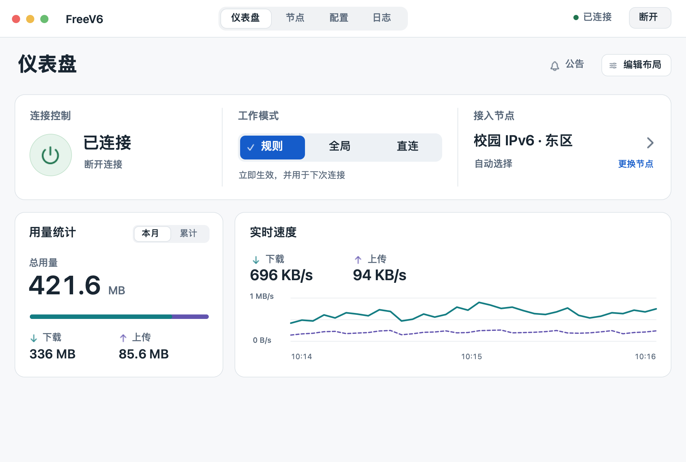
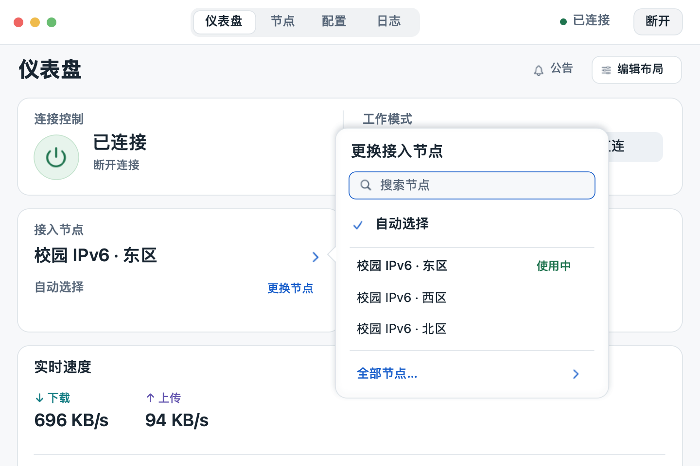

# FreeV6 macOS 界面优化计划

2026 年 11 月 6 日 · 设计提案 · 适用范围为 macOS 原生客户端

**实施状态：** 本计划已应用到 macOS 客户端。[查看实际窗口、验收结果和未覆盖的发布环境](../audits/2026-11-06-macos-ui/implementation.md)。下文保留原提案和验收目标。

**建议把仪表盘的第一行交给日常操作，第二行交给流量数据。** 打开窗口，用户能直接看到连接状态、三个工作模式和当前接入节点。切模式只点一次；断开、恢复、结束编辑都能在当前位置完成。以下是下一轮的设计和验收目标。上一轮的现状证据单独保存在[审查报告](../audits/2026-11-06-macos-ui/README.md)。

*默认窗口的静态设计示意。节点、曲线和流量均为示例数据。颜色以浅色外观示意，最终采用系统语义色并分别验收浅、深色。*

## 1. 窗口如何组织

| 区域 | 920 × 620 pt 默认窗口 | 720 × 480 pt 最小窗口 |
|---|---|---|
| 窗口标题栏 | 左侧窗口控制，中部四个目的地，右侧连接状态与当前会话动作。四个标签不随页面工具移动。 | 保留四个可见文字标签、状态和会话动作。节点搜索及日志筛选放入各自的页面工具行。 |
| 仪表盘页头 | 「仪表盘」和右侧「公告／编辑布局」在滚动区外。编辑时右侧原位换为「添加／取消／完成」。 | 相同位置；必要时把公告等次要动作收入「更多」。编辑期间「取消／完成」直接可见。 |
| 默认操作布局 | 第一排依次为 **连接控制、工作模式、接入节点**。三个区域共用平整的表面，用细分隔线对齐。 | 第一排为连接与三个模式按钮；第二排为节点与用量。默认布局正常字号下，连接、模式、节点入口都在首屏。 |
| 默认数据布局 | 第二排左侧显示用量，右侧实时速度跨两列。图表拥有自己的高度。 | 速度图移到下一排并跨两列，纵向滚动可查看；滚动时始终可以断开或结束编辑。 |

**自定义布局。** 上表是新用户和主动「恢复默认布局」的顺序。继续保留五种组件的稳定 ID、添加／移除、紧凑／宽幅、拖动和菜单排序。已有存档按原顺序和跨度显示，有效的空布局继续为空。相邻操作组件按当前位置拼接；被移至数据组件旁边或单独成行时也能独立呈现。编辑态每个组件分别出现操作边界和手柄。验收首屏顺序只针对默认布局。

**视觉规格。** 建议从 20 pt 的页边距、12 pt 的区间距、8 pt 的控件间距起步。日常控制区约 100–140 pt 高，随文字换行增长。各组件按内容定高，替换现有的统一高度下限。页面标题、分组标题、状态值、辅助说明分别使用稳定的系统字体层级，数值用等宽数字。系统强调色用于选中和主操作，绿色用于已连接，警告同时使用图标和文字，青绿／靛蓝分别对应下载／上传。浅色下载标签在现状截图中约为 2.3:1，调整后用实际渲染的普通文字前景／背景复验 4.5:1 的设计目标。[浅深色审查证据](../audits/2026-11-06-macos-ui/README.md)

## 2. 四块控件的设计与行为

### 工作模式 · 三个始终可见的按钮

- **外观。** 从左到右固定为「规则」「全局」「直连」，三段等宽，建议高度 32–36 pt。选中段用强调色实底、勾选和较重字重；未选段保持中性。三个按钮预留相同的标记空间，切换时文字不跳。同一组控件用于紧凑和宽幅组件，窄窗仍显示完整中文。
- **操作。** 点一次直接切换。当前态取自服务已确认的模式；请求未结束时在目标段显示进行中，保留原选中标记，阻止重复提交。成功再移动勾选。失败后回读真实状态，在模式组下给出重试。点击已选段不重发。
- **作用范围。** 组下常驻短句「立即生效，并用于下次连接」。若会话已切换但默认值保存失败，明确显示例如「当前已切至全局；下次连接仍用规则」，只有在旧值已确认时才写出具体值，否则提示「下次默认值未确认」并给「查看配置」。保留配置页其他尚未提交的草稿。
- **离线与键盘。** 未连接时三段仍可见，运行态不勾选，显示「连接后可切换」及「设置下次模式」入口。配置页的「下次连接模式」也用相同顺序的三段选择，沿用 ⌘S 保存。主窗口与设置的控件语义可分别读出“当前工作模式”和“下次连接模式”；可用键盘焦点与方向键选择。系统菜单栏则将三个选项直接列在「工作模式」分组下，用原生勾选项表示当前值。
- **验收。** 两种窗口、两种组件尺寸下，均能一次从规则切到直连。依次测试快速连点、切换失败、切换成功但保存失败、操作中断线，以及配置页已有未保存草稿。

当前仅宽幅组件直接展示三段，紧凑版走菜单。实现时把现有三段交互提取为共用控件，继续调用 `changeMode` 和 `saveConfirmedMode`；运行态和默认值各以自己的确认结果为准。[现有模式组件](../../../macos/Sources/FreeV6App/DashboardCards.swift) · [模式命令](../../../macos/Sources/FreeV6App/AppModel.swift) · [默认值与草稿](../../../macos/Sources/FreeV6App/BusinessSettingsView.swift)

### 连接控制 · 圆形按钮和明确的动词

- **外观。** 用约 52–56 pt 的圆形电源键取代整块渐变长方形。圆键旁显示状态大字和动作文字，例如「已连接」下方写「断开连接」。圆键和动词属于同一个按钮命中区，状态文字始终可读。已连接时用低饱和绿和细边界，未连接时用系统强调色提示可以开始。平稳运行时保持静止。
- **全局入口。** 标题栏右侧持续显示短状态和一个带文字的动作。卡片供日常操作，标题栏供滚动、编辑、切页或移除组件后使用；两处调用同一条命令。编辑态禁用组件内部网络操作，标题栏动作继续遵循正常可用性。

| 当前状态 | 用户看到和能做的事 |
|---|---|
| 已就绪、未连接 | 显示「未连接」与「连接」。一次点击发起一次请求。 |
| 需要准备 | 显示具体缺项。按现有命令进入网络服务设置、核心准备或连接准备。 |
| 正在连接／正在断开 | 保留原布局，显示进度和对应文字；操作暂时禁用。 |
| 已连接 | 显示「已连接」与「断开连接」。按钮的辅助功能名称包含动作。 |
| 网络需要恢复 | 本人会话可恢复时显示「重试恢复网络」。无法确定目标会话时提供「刷新状态」。 |
| 被其他用户占用／状态未知 | 显示占用或待确认的原因，按命令可用性提供刷新。 |

**验收。** 同一会话在仪表盘、固定标题栏、节点页和菜单栏显示一致。滚到最后一项、进入编辑或删掉连接组件，仍可执行允许的断开／恢复动作。快速点击两个入口只发起一次有效操作。[会话状态与动作分派](../../../macos/Sources/FreeV6Desktop/DesktopCommands.swift) · [当前工具栏显示条件](../../../macos/Sources/FreeV6App/NativeCommands.swift)

### 用量统计 · 先读总量，再读方向

- **外观。** 左上「用量统计」，右上「本月／累计」。主数字表达所选周期的总用量，下面分别显示「↓ 下载」与「↑ 上传」和精确到展示单位的数值。示意数据为总量 **421.6 MB**、下载 **336 MB**、上传 **85.6 MB**。
- **图形。** 用一条细的双色水平带代替圆环，表达上传与下载在总量中的组成。两端的数据标签始终可见；图条没有“满额”、配额或剩余流量的含义。缩窄时优先让数值上下排列，宽幅仍展示相同口径。实时速率及时间趋势属于旁边的速度组件。
- **数据状态。** 月份由账本返回的 `month` 决定；「本月」用 `monthly`，「累计」用 `total`，总量由同周期上下行字节安全相加后统一格式化。已知为零显示「0 B」与中性空条；首次加载显示读取中。刷新失败时保留可用旧值并标明「上次读取」和「重试」。断线后仍可查看历史。
- **验收。** 覆盖零值、只上传、只下载、两者均有、跨月、超大值和加载失败。切周期后总量、分项和比例一起更新；读屏能直接读出周期和三个数，无需辨认颜色。截图数字只用于示意，产品使用现有格式化规则。[账本字段](../../../macos/Sources/FreeV6Business/WorkerProtocol.swift) · [现有用量展示](../../../macos/Sources/FreeV6App/DashboardCards.swift)

### 接入节点 · 直接点当前节点更换

*720 × 480 pt 示意。浮层锚定节点行，根据可用空间换侧。关闭后焦点回到原行，窗口尺寸与原页面位置都能保留。*

- **入口。** 将节点名称、策略和右箭头组成一条可点击的整行。首行以主文字显示「校园 IPv6 · 东区」，下方写「自动选择」或「首选：西区」，尾部保留「更换节点」文字。鼠标悬停时整行出现轻微背景，键盘焦点圈覆盖整行。长名称允许两行，完整名称可在选择器和读屏中读取。
- **打开后。** 在这一行旁展开原生浮层，焦点进入搜索框。自动组先列「自动选择」，再列当前节点、最近节点和少量常用候选并去重；输入查询时搜索当前组的全部成员。底部「全部节点…」进入与当前分组对应的节点页，提供完整列表和测速。若没有接入组但存在其他可用组，以该组真实名称展示，保留前往其他组的路径。
- **选中含义。** 勾选表示**选择策略或首选项**，「使用中」表示**正在承载流量的节点**。自动选择时可以同时看到「✓ 自动选择」与「东区 · 使用中」；指定首选后以服务确认结果为准。选择成功收起浮层并把焦点还给节点行；失败保留查询、候选和重试入口。Esc 关闭，方向键浏览，Return 确认。
- **状态。** 将正在读取、已读取但为空、读取失败、未连接、恢复失败分开。故障正文与标题栏给同一动作。已连接状态下读取失败就地重试，后续读取成功只清掉对应的读取错误。筛选词与清除操作在 720 pt 仍可见。把测速范围写进按钮，例如「测量 1 个结果」和「测量全组 3 个节点」。
- **验收。** 在 920 pt 搜东区后缩到 720 pt，可看到并清除筛选；在自动、手动首选、分组切换、无结果、超时恢复及浮层打开时断线的情况下，标记、实际会话和反馈一致。[原有快捷候选与节点页](../../../macos/Sources/FreeV6App/LiveNetworkViews.swift) · [节点确认与测速](../../../macos/Sources/FreeV6Desktop/DesktopCoreControls.swift)

## 3. 把上轮审查一起落实

以下编号来自[19 项审查发现](../audits/2026-11-06-macos-ui/README.md)。同一版拆成可以独立验收的工作，先处理影响操作的位置与状态，再做外观收尾。

| 工作 | 对应审查项 | 完成条件 |
|---|---|---|
| 稳定主窗口和设置窗口 | 01、06、07、18 | 顶部四个标签的水平位置稳定；编辑操作常驻。设置继续使用左侧原生分栏，把收起按钮并入标题行，让分类与正文对齐。验证 780 × 550 和 640 × 440 pt 的设置窗口，以及左右栏的键盘导航。日志状态说明与标题共用左缘。 |
| 仪表盘四块重排与数据层级 | 08、09、10 | 交付上述四个组件；速度曲线保持独立高度。浅深色、键盘焦点、选中与禁用均可区分。验证空布局、旧布局、恢复默认和宽窄来回切换。 |
| 节点搜索、测速和状态 | 02、03、11、15 | 窄窗保留查找与清除；按结果测速与整组测速范围明确；读取失败、合法空组和恢复失败各有自己的说明及下一步。 |
| 首次准备、配置失败与导入 | 04、05、12、13、14、19 | 准备未就绪时显示「稍后继续」，错误出现在发起步骤。订阅／备用地址失败保留遮蔽输入；规则错误打开对应字段及行号。页级保存明确覆盖范围。从设置发起、取消导入后回到设置；帮助与恢复文案统一称「仪表盘」。 |
| 编辑退出和未读公告 | 16、17 | 只有实际布局改动才在退出前处理草稿，提供保存、放弃、返回编辑；关闭窗口重开能继续。公告直接显示首条未读，只将看过的条目或明确指定的全部条目标为已读。 |

## 4. 实施顺序与验收门槛

| 顺序 | 交付内容 | 通过后再进入下一步 |
|---|---|---|
| **一 · 把窗口骨架搭稳** | 主导航、固定页头、全局会话动作、设置侧栏，调整按内容测量高度的组件布局。重点文件为 `OverviewView`、`NativeToolbar`、`DashboardGrid`、`DashboardLayout`、`PreferencesView`。 | 两种主窗口尺寸下，逐页切换、滚到底、编辑最后一项都找得到主要动作；旧布局解码、空布局、排序和手柄仍正确。 |
| **二 · 交付四个核心组件** | 圆形连接键、三段模式按钮、用量数字与比例带、节点行和选择浮层；接回同一套命令、会话和流量账本。 | 在隔离会话走通「连接 → 切全局 → 选节点 → 看本月／累计 → 断开」。每一步在标题栏、页面和菜单获得一致结果，错误可在原处重试。 |
| **三 · 补全失败与退出流程** | 窄窗查找、测量范围、准备失败、导入和字段校验、草稿、公告、日志及帮助文案。 | 注入超时、拒绝授权、默认值保存失败、操作期间换会话等情况。旧会话结果不会覆盖新会话；输入、筛选、焦点和错误都有明确归属。 |
| **四 · 原生与视觉回归** | 更新隔离场景和现有布局／命令测试，运行原生测试，用同一组场景截图对比；正式包另验系统集成。 | 默认／最小窗口分别检查浅深色、键盘及 VoiceOver；复核增强对比度、减少透明度、减少动态效果。分别记录 macOS 14 回退和当前系统结果，真实服务行为在相应测试环境单独验收。 |

**第一轮评审只看五件事。** 在 720 × 480 pt 的默认首页，能否一眼找到断开，能否一次点中三种模式之一，能否直接打开当前节点并改选，能否读出本月总量及上下行，以及在页面底部能否直接完成编辑。做到这五件事，再评卡片的边界、颜色和留白。
